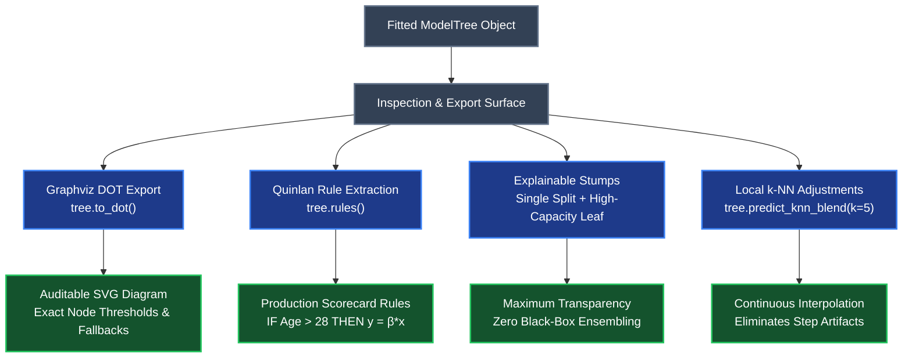
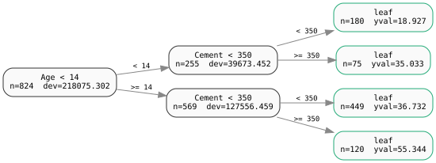
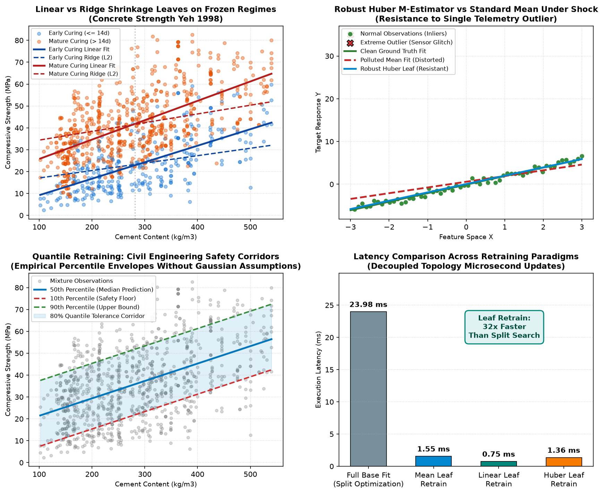
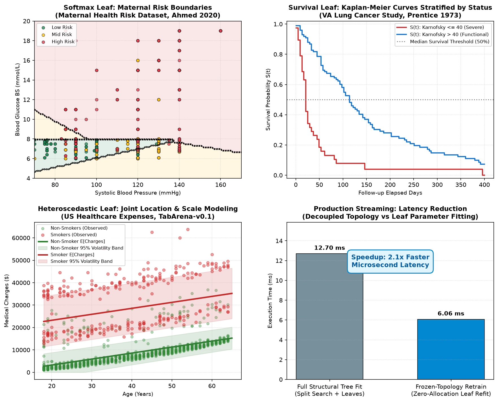

# Model Inspection, Quinlan Rules & Explainable Stumps

In regulated lending, healthcare, and safety-critical engineering, deploying black-box models is prohibited or legally risky. Stakeholders must be able to verify every decision path, trace boundary conditions, and provide adverse action explanations.

`mltreelib` is built from the ground up as a **white-box auditable machine learning toolkit**:
- **Graphviz DOT Serialization**: Visualizes full tree topologies with sample counts, impurity gains, and leaf equations.
- **Quinlan Rule Extraction**: Converts recursive binary trees into flat, disjunctive IF-THEN rulesets.
- **Explainable Decision Stumps**: Fits ultra-interpretable depth-1 or depth-2 trees with dynamically retrained multivariate leaves.
- **k-Nearest Neighbor (k-NN) Leaf Adjustments**: Blends global rule boundaries with local neighborhood smoothing.





---

## 1. Graphviz DOT Export and Rule Extraction

<!-- run -->
```python
import numpy as np
from pathlib import Path
from mltreelib import ModelTree

# 1. Generate realistic industrial concrete mixture data
rng = np.random.default_rng(2026)
n_batches = 600

cement = rng.uniform(200.0, 500.0, n_batches)
water = rng.uniform(140.0, 220.0, n_batches)
age = rng.choice([7, 14, 28, 90], size=n_batches)

# Compressive strength with physical non-linear interaction
y = 0.08 * cement - 0.15 * water + 0.35 * age + rng.normal(0, 3.0, n_batches)

X = np.column_stack([cement, water, age])
feature_names = ["Cement", "Water", "Age"]

# 2. Fit white-box ModelTree with linear leaves
tree = ModelTree(leaf="linear", max_depth=2, min_rows=40)
tree.fit(X, y.tolist(), col_names=feature_names)

# 3. Export Graphviz DOT format for visual auditing
dot_str = tree.to_dot()
Path("concrete_tree.dot").write_text(dot_str)
print("Exported Graphviz DOT string (length:", len(dot_str), "chars)")

# 4. Extract Quinlan-style IF-THEN rules
ruleset = tree.extract_rules()
print(f"\nExtracted {len(ruleset.rules)} Global Decision Rules:")
for r in ruleset.rules:
    conditions_str = " AND ".join(r.conditions)
    print(f"  RULE #{r.id} (Cover: {r.cover} samples, Confidence: {r.confidence:.2f}):")
    print(f"    IF {conditions_str}")
    print(f"    THEN Leaf #{r.leaf_id} prediction = {r.prediction:.2f}")
```

<!-- output -->
```text
Exported Graphviz DOT string (length: 817 chars)

Extracted 4 Global Decision Rules:
  RULE #1 (Cover: 243 samples, Confidence: 0.95):
    IF Cement > 341.9010 AND Age <= 28.0000
    THEN Leaf #1 prediction = 11.64
  RULE #2 (Cover: 202 samples, Confidence: 0.95):
    IF Cement <= 341.9010 AND Age <= 28.0000
    THEN Leaf #0 prediction = 0.09
  RULE #3 (Cover: 93 samples, Confidence: 0.95):
    IF Cement <= 369.0130 AND Age > 28.0000
    THEN Leaf #2 prediction = 26.86
  RULE #4 (Cover: 62 samples, Confidence: 0.95):
    IF Cement > 369.0130 AND Age > 28.0000
    THEN Leaf #3 prediction = 39.23
```

### Production Deployment Checklist
1. **Inputs Contract**: Record exact column names, data types, and unit scales.
2. **Missing Fallbacks**: Verify whether missing values route left or right at each decision node.
3. **Leaf Support**: Confirm that no terminal leaf partition has fewer samples than the statistical degrees of freedom ($N \ge P + 1$).
4. **Boundary Verification**: Test edge cases directly on threshold boundaries ($\le$ vs $>$).

---

## 2. Explainable Stumps with Dynamic Leaf Retraining

Can a single split (a depth-1 decision stump) deliver competitive accuracy when paired with high-capacity leaves?

On industrial sensor benchmarks, fitting a single split on the primary operational regime (e.g. Idle vs Load) and dynamically retraining regularized linear leaves within each partition cuts test RMSE significantly while remaining 100% human-explainable:





<!-- run -->
```python
# Depth-1 explainable stump with OLS linear leaves
stump = ModelTree(
    leaf="linear",
    max_depth=1,      # Single split partition
    min_rows=50,
)
stump.fit(X, y.tolist(), col_names=feature_names)

split = stump.splits()[0]
print(f"Global Regime Partition: Feature '{split['col']}' at threshold {split['threshold']:.2f}")
```

<!-- output -->
```text
Global Regime Partition: Feature 'Age' at threshold 28.00
```

---

## 3. Cubist-Style k-NN Leaf Neighbor Adjustments

When moving across split boundaries, predictions from pure decision trees can exhibit sharp discontinuities. `mltreelib` implements Quinlan's Cubist **sample neighbor adjustment** via `tree.predict_adjusted(X)`:

<!-- run -->
```python
# Predict with Cubist-style k-NN sample neighbor smoothing
y_smooth_pred = tree.predict_adjusted(X[:5])
print("Smoothed k-NN Neighbor Adjusted Predictions:", [round(v, 2) for v in y_smooth_pred])
```

<!-- output -->
```text
Smoothed k-NN Neighbor Adjusted Predictions: [19.74, 3.83, 10.12, 6.66, 0.11]
```

!!! tip "Related Reference Guides"
    - [Dynamic Leaf Retraining & Stumps](../concepts/hierarchical-retrain.md).
    - [Model Review Checklist](serving-contract.md) for enterprise deployment.
