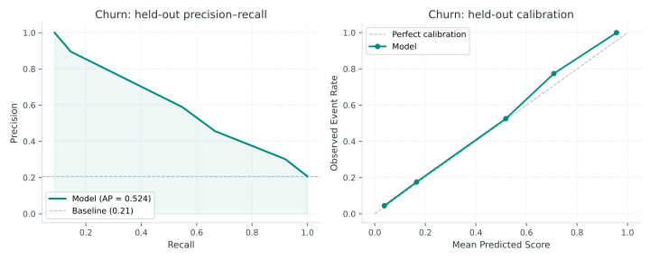

# Get the real datasets

Clone the repository and run the examples from its root. The examples use pandas and matplotlib. Use the repository checkout for examples that import a helper from the `examples` directory. Install Graphviz if you want to regenerate the optional fitted-tree diagrams.

```bash
uv sync
uv run python -c "import pandas, matplotlib, mltreelib"
```

For an OpenML source below, open its dataset page and download the Parquet file. The `parquet_url` field in the [OpenML data description](https://www.openml.org/api/v1/json/data/46964) gives its direct location. Save it under the listed path. These files are excluded from Git.

| Dataset | Source | Local path | Study |
|---|---|---|---|
| Diamonds | [OpenML 46923](https://www.openml.org/d/46923) | `datasets/diamonds.parquet` | [Regression](regression.md) |
| Give Me Some Credit | [OpenML 46929](https://www.openml.org/d/46929) | `datasets/GiveMeSomeCredit.parquet` | [Classification](classification.md) |
| Wine Quality | [OpenML 46964](https://www.openml.org/d/46964) | `datasets/wine_quality.parquet` | [Clustering](clustering.md) |
| Statlog Shuttle | [UCI 148](https://archive.ics.uci.edu/dataset/148/statlog+shuttle) | `datasets/external/shuttle/` | [Anomaly detection and archive setup](anomaly.md) |
| FLCHAIN | [Rdatasets CSV](https://vincentarelbundock.github.io/Rdatasets/csv/survival/flchain.csv) | `datasets/external/real_eval/flchain.csv` | [Survival](survival.md) |
| Hillstrom | [CSV mirror](https://raw.githubusercontent.com/AdityaDabrase/ab-testing-email-marketing/main/data/raw/hillstrom.csv) | `datasets/external/real_eval/hillstrom.csv` | [Uplift and source checks](uplift.md) |
| APS Failure | [OpenML 46908](https://www.openml.org/d/46908) | `datasets/APSFailure.parquet` | [Missing sensor data](../blog/zero-imputation-predictive-maintenance.md) |
| Concrete strength | [OpenML 46917](https://www.openml.org/d/46917) | `datasets/concrete_compressive_strength.parquet` | [Local models and rules](piecewise-linear-and-cubist.md) |
| Miami housing | [OpenML 46942](https://www.openml.org/d/46942) | `datasets/miami_housing.parquet` | [Distributional splits](distributional-and-censored-trees.md) |

For the full TabArena collection, see the [dataset manifest](https://github.com/jkapila/mltreelib/blob/main/datasets/MANIFEST.md).

## Secondary example: bank churn

Use [OpenML 46911](https://www.openml.org/d/46911) at `datasets/Bank_Customer_Churn.parquet` to compare three interfaces on the same mixed feature schema. The script fits a churn classifier, a cluster tree and an anomaly tree. Only the classifier uses churn labels.

```bash
uv run python examples/guides/real_data_workflow.py
```



This split uses 6,000 training, 2,000 validation and 2,000 test rows. The classifier's test Brier score is 0.1215, compared with 0.1639 for a constant training-rate prediction. The unsupervised outputs describe this customer table. A churn outcome cannot validate an anomaly ranking or determine whether a segment is actionable.
