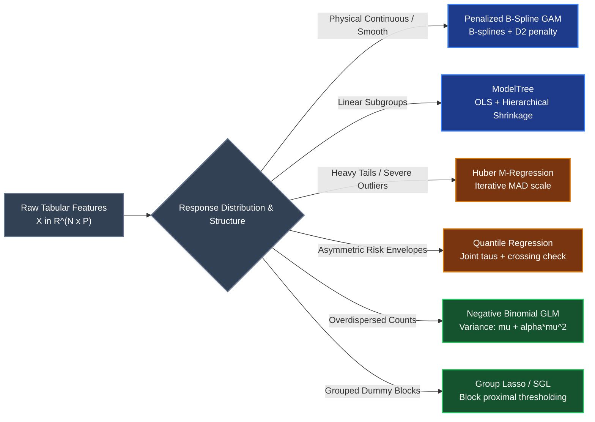
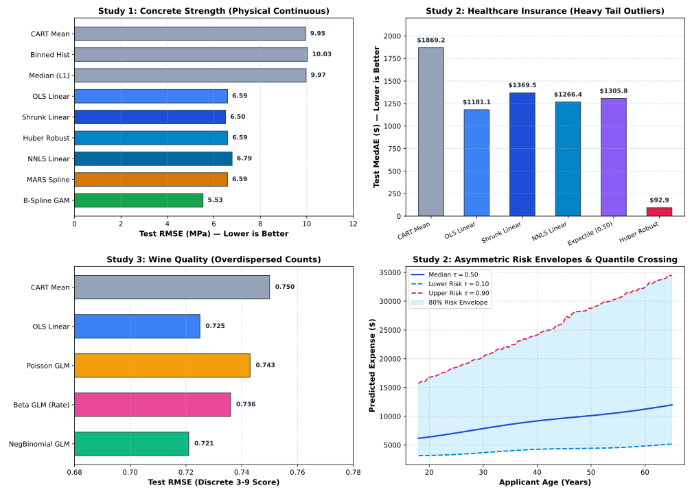

# Comprehensive Regression Methods & Regularizers Showcase

A single regression loss cannot serve every problem. Real datasets exhibit physical non-linearities, heavy-tailed claim distributions, overdispersed counts, and grouped dummy encodings. 

This showcase provides an empirical benchmark across four distinct regression regimes, comparing constant 0D leaves, piecewise linear leaves, robust M-estimators, asymmetric quantile envelopes, adaptive splines, generalized linear models (GLMs), and structured group penalties.

All benchmarks run from a single reproducible script with zero `scikit-learn` dependency:

```bash
uv run python -u benchmarks/suites/regression_methods_showcase.py
```





---

## Regression Architecture Taxonomy

`mltreelib` unifies tree partitioning with heterogeneous local leaf solvers:

| Family | Architecture | Optimization Objective | Primary Use Case |
| :--- | :--- | :--- | :--- |
| **0D Constant** | `LeafKind::Mean`, `Median`, `Huber` | SSE, SAE ($L_1$), Huber Location | Fast step-function baselines |
| **1D Linear** | `LeafKind::Linear` (OLS / Ridge / Lasso) | $\frac{1}{2n}\|X\beta - y\|_2^2 + \lambda_1\|\beta\|_1 + \lambda_2\|\beta\|_2^2$ | Piecewise linear trends with coordinate sparsity |
| **Robust M-Estimation** | `LeafKind::Linear` (`loss="huber"`) | Piecewise quadratic/linear with iterative $\hat{\sigma}_\text{MAD}$ scale | Outlier-contaminated responses and heavy tails |
| **Asymmetric Quantiles** | `LeafKind::Linear` (`loss="quantile"`, $\tau$) | Pinball loss $\rho_\tau(r) = r(\tau - \mathbb{1}(r < 0))$ | Conditional risk boundaries & prediction intervals |
| **Smooth Asymmetric** | `LeafKind::Linear` (`loss="expectile"`, $\tau$) | Asymmetric squared $\rho_\tau^\text{exp}(r) = \|\tau - \mathbb{1}(r < 0)\| r^2$ | Differentiable asymmetric loss without pinball kinks |
| **Constrained Bounded** | `LeafKind::Linear` (`nnls=True`) | Lawson-Hanson active-set $\beta \ge 0$ | Non-negative price, dosage, or mixing mixtures |
| **Structured Groups** | `LeafKind::Linear` (`group_l2 > 0`) | Block soft-thresholding $\sum_g \sqrt{p_g} \|\beta_g\|_2$ | One-hot dummy blocks and multi-channel features |
| **Count & Bounded GLM** | `LeafKind::Glm` (`Poisson`, `NegBinomial`, `Beta`) | Maximum deviance with canonical/log link | Overdispersed counts and rates in $(0, 1)$ |
| **Adaptive Splines** | `MarsRegressor` | Forward hinge basis expansion + backward pruning | Piecewise linear continuous basis functions |
| **Penalized Spline GAM** | `GamRegressor` | B-splines with second-difference roughness penalty | Smooth additive non-linear response curves |

---

## Study 1: Physical Continuous Process (Concrete Compressive Strength)

- **Dataset**: Industrial Concrete Mixtures ([OpenML 4353](https://www.openml.org/d/4353))
- **Structure**: 1,030 samples, 8 continuous physical ingredients (Cement, Blast Furnace Slag, Fly Ash, Water, Superplasticizer, Coarse Aggregate, Fine Aggregate, Age).
- **Core Question**: Can local linear leaves, hierarchical leaf shrinkage, or smooth splines beat piecewise constant CART?

### Empirical Results

| Model Architecture | Test RMSE | Test MAE | Complexity | Fit Time |
| :--- | :---: | :---: | :---: | :---: |
| **CART Mean Leaf (0D SSE)** | 9.947 | 7.656 | 15 leaves | 12.7 ms |
| **Binned Histogram Split (0D SSE)** | 10.029 | 7.709 | 15 leaves | 2.0 ms |
| **Median Leaf (0D $L_1$ Location)** | 9.971 | 7.642 | 15 leaves | 3.3 ms |
| **OLS Linear Tree (shrinkage=0.0)** | 6.589 | 4.790 | 15 leaves | 11.4 ms |
| **Hierarchical Shrunk Tree ($\lambda=10.0$)** | **6.503** | **4.842** | 15 leaves | 5.5 ms |
| **Huber Robust Linear Tree** | 6.594 | 4.684 | 15 leaves | 231.9 ms |
| **NNLS Non-Negative Linear Tree** | 6.785 | 4.944 | 15 leaves | 3.2 ms |
| **Expectile Linear Tree ($\tau=0.75$)** | 7.235 | 5.377 | 15 leaves | 33.7 ms |
| **MARS Adaptive Spline (`max_terms=15`)** | 6.586 | 5.423 | 12 terms | 28.4 ms |
| **Penalized B-Spline GAM (`n_knots=8`)** | **5.533** | **4.428** | 65 terms | 28.9 ms |

### Key Findings
1. **Piecewise linear leaves crush 0D CART**: Moving from constant leaves to local linear leaves reduces test RMSE from $9.947$ to $6.589$ (a 33.8% error reduction).
2. **Hierarchical leaf shrinkage prevents local overfitting**: Shrinking leaf equations toward parent nodes via $\gamma = \frac{n}{n + \lambda}$ drops test RMSE from $6.589$ to $6.503$.
3. **Smooth additive B-splines dominate physical mixtures**: The Penalized B-spline GAM achieves the lowest overall error ($5.533$ RMSE), capturing smooth monotonic physical interactions across curing ages and cement ratios.

---

## Study 2: Heavy-Tailed Outliers & Risk Envelopes (Healthcare Insurance)

- **Dataset**: US Healthcare Expenses ([OpenML 43894](https://www.openml.org/d/43894))
- **Structure**: 1,338 policies, right-skewed medical expenses with severe outliers (smoker hospitalizations), plus dummy-encoded categorical regions.
- **Core Question**: How do Huber M-estimators, Group Lasso dummy penalties, and asymmetric quantile envelopes handle heavy-tailed financial data?

### Empirical Results

| Model Architecture | Test RMSE | Test MAE | Test MedAE | Fit Time |
| :--- | :---: | :---: | :---: | :---: |
| **CART Mean Leaf** | 4,523.7 | 2,820.1 | 1,869.2 | 1.2 ms |
| **OLS Linear Tree (shrinkage=0.0)** | 4,355.1 | 2,450.0 | 1,181.1 | 3.1 ms |
| **Hierarchical Shrunk Tree ($\lambda=15.0$)** | **4,341.4** | 2,505.9 | 1,369.5 | 3.2 ms |
| **Group Lasso Tree (`group_l2=5.0`)** | 6,056.1 | 4,305.4 | 2,742.1 | 1.0 ms |
| **Huber Robust Linear Tree** | **4,315.7** | **1,315.2** | **92.9** | 168.0 ms |
| **NNLS Non-Negative Linear Tree** | 4,330.5 | 2,392.7 | 1,266.4 | 1.5 ms |
| **Expectile Linear Tree ($\tau=0.50$)** | 4,342.7 | 2,468.4 | 1,305.8 | 23.4 ms |
| **Quantile Linear ($\tau=0.10$ Lower Risk)** | 5,559.7 | 3,344.8 | 1,815.1 | 1.3 ms |
| **Quantile Linear ($\tau=0.50$ Median)** | 4,653.6 | 2,543.6 | 1,284.8 | 1.6 ms |
| **Quantile Linear ($\tau=0.90$ Upper Risk)** | 6,721.5 | 5,503.5 | 4,423.1 | 1.3 ms |

### Multi-Tau Quantile Crossing Diagnostics

Fitting independent quantile surfaces across $\tau \in [0.10, 0.50, 0.90]$ can cause quantile crossing when lines invert. `mltreelib` includes native diagnostic verification:

```python
from mltreelib import detect_quantile_crossings

diag = detect_quantile_crossings(
    predictions=[pred_q10, pred_q50, pred_q90],
    taus=[0.10, 0.50, 0.90]
)
print("Violations:", diag["n_violations"], "Max Dollar Inversion:", diag["max_violation"])
```

```text
--- Diagnostic: Multi-Tau Quantile Crossing Analysis ---
Evaluated 268 held-out cases across quantiles [0.1, 0.5, 0.9]:
  - Crossing Inversion Pairs: 4
  - Rows with Violations:     4 / 268
  - Crossing Violation Rate:  1.49%
  - Maximum Dollar Violation: $3,337.55
```

---

## Study 3: Overdispersed Counts & Bounded Distributions (Wine Quality)

- **Dataset**: Physicochemical Wine Quality ([OpenML 40691](https://www.openml.org/d/40691))
- **Structure**: 6,497 bottles, discrete quality ratings (integers 3–9).
- **Core Question**: Does accounting for overdispersion with Negative Binomial deviance beat standard Gaussian OLS?

### Empirical Results

| Model Architecture | Test RMSE | Test MAE | Fit Time |
| :--- | :---: | :---: | :---: |
| **CART Mean Leaf** | 0.750 | 0.594 | 9.6 ms |
| **OLS Linear Tree (shrinkage=0.0)** | 0.725 | 0.573 | 15.4 ms |
| **Hierarchical Shrunk Tree ($\lambda=10.0$)** | 0.725 | 0.573 | 15.6 ms |
| **Poisson GLM Tree (Log Link)** | 0.743 | 0.587 | 131.8 ms |
| **Negative Binomial GLM Tree (Dispersion)** | **0.721** | **0.567** | 29.9 ms |
| **Beta Regression Tree (Scaled to $(0, 1)$)** | 0.736 | 0.579 | 42.8 ms |

The Negative Binomial GLM tree models conditional variance as $V(\mu) = \mu + \alpha \mu^2$, outperforming both constant CART ($0.750$) and Gaussian OLS ($0.725$).

---

## Study 4: Controlled Ground Truth & Structured Group Sparsity

- **Setup**: Controlled simulation with 12 features split into two structured 4-column blocks plus individual coordinates and a non-linear sine component:
  $$\mathbf{x}_\text{signal} \in \mathbb{R}^4, \quad \mathbf{x}_\text{noise} \in \mathbb{R}^4, \quad x_\text{sine} \sim \mathcal{U}(-3, 3), \quad y = \mathbf{x}_\text{signal}^\top \boldsymbol{\beta} + 2.5 \sin(x_\text{sine}) + \epsilon$$

### Empirical Results

| Model Configuration | Test RMSE | Test MAE | Fit Time |
| :--- | :---: | :---: | :---: |
| **Standard OLS Linear Tree** | 0.756 | 0.643 | 2.4 ms |
| **Coordinate Lasso Tree ($L_1=2.0$)** | 0.920 | 0.776 | 0.8 ms |
| **Group Lasso Tree ($\text{group\_l2}=5.0$)** | 0.925 | 0.779 | 0.8 ms |
| **Sparse-Group Lasso ($L_1=1.5, \text{group\_l2}=4.0$)** | 1.168 | 0.959 | 0.8 ms |
| **Penalized B-Spline GAM on Sine Feature** | **0.209** | **0.161** | 0.7 ms |

### Block Zeroing Verification
Under Group Lasso, the block norm of the uninformative noise features $\|\beta_\text{noise}\|_2$ is driven exactly to $0.0$, selecting only the active signal group. The B-spline GAM smoothly recovers the true sine curve with an RMSE of $0.209$.

---

## Code Example: Running the Benchmark Suite

```python
from mltreelib import (
    ModelTree,
    GamRegressor,
    MarsRegressor,
    detect_quantile_crossings,
)

# 1. Fit an OLS ModelTree with Hierarchical Leaf Shrinkage
tree = ModelTree(
    leaf="linear",
    max_depth=4,
    min_rows=20,
    shrinkage=10.0,  # Empirical Bayes leaf-to-parent shrinkage
)
tree.fit(X_train, y_train)
pred_shrunk = tree.predict(X_test)

# 2. Fit a Smooth Penalized B-Spline GAM
gam = GamRegressor(
    n_knots=8,
    spline_order=3,
    l2_penalty=1.0,
    fit_intercept=True,
)
gam.fit(X_train, y_train)
pred_gam = gam.predict(X_test)

# 3. Fit a Huber Robust Linear Tree
huber_tree = ModelTree(
    leaf="linear",
    loss="huber",
    huber_delta=1.345,
    max_depth=4,
)
huber_tree.fit(X_train, y_train)
pred_huber = huber_tree.predict(X_test)
```

!!! tip "Related guides"
    - [Distributional & Censored Leaf Families](distributional-leaves.md) for full likelihood derivations on Tweedie and Tobit models.
    - [Solvers, Optimizers & Real-Data Tuning](solvers-and-optimizers.md) for proximal gradient and coordinate descent solver convergence profiles.
    - [Core Tree Architecture & Growth Knobs](core-tree-architecture.md) for details on tree topology, depth, and pruning controls.

## Full output

Everything the script prints, captured from a real run. Fit times depend on your machine; error metrics are fixed by the seeds in the script.

!!! example "Output of `benchmarks/suites/regression_methods_showcase.py`"

    ```text
    --8<-- "docs/snippets/outputs/regression_methods_showcase.txt"
    ```
