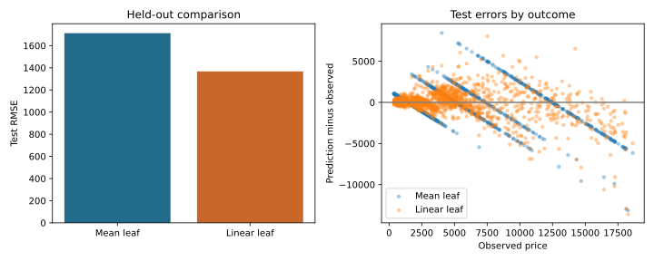
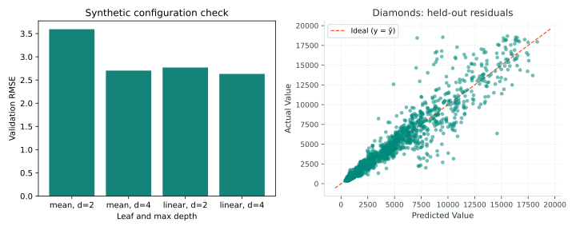

# Decision tree regression in Python: estimate diamond prices

Predict the listed price of a diamond from its measurements and grading labels. Compare a simple baseline and two tree configurations. Inspect the largest errors before using the score for a pricing decision.

## 1. Get the data and make the split

Save the [OpenML diamonds dataset 46923](https://www.openml.org/d/46923) to `datasets/diamonds.parquet`. It contains 53,940 records. Use 6,000 rows to fit and 2,000 independent rows to evaluate. A production pricing study needs a split that respects listing date, seller and repeated items where available.

The input includes numeric measurements such as carat and raw labels for cut, color and clarity. Keep those labels as strings. Select the target and feature order once.

**Next:** fit the mean-leaf and linear-leaf trees on the 6,000 training rows and score the 2,000 test rows against the training-mean baseline.

## 2. Fit and compare

<!-- run -->
```python
from statistics import mean

import pandas as pd
from mltreelib import Metrics, ModelTree
from mltreelib.data import select_rows, take, train_test_split, xy

from mltreelib import dataset_path
df = pd.read_parquet(dataset_path("diamonds"))

# Seeded 8,000-row subset, then 6,000 rows to fit and 2,000 rows to evaluate
sub, _ = train_test_split(len(df), test_size=len(df) - 8000, seed=2026)
d = xy(take(df.to_dict("list"), sub), "price")
train_idx, test_idx = train_test_split(8000, test_size=2000, seed=2026)
train, test = select_rows(d, train_idx), select_rows(d, test_idx)
x_train, x_test = train["x"], test["x"]
y_train, y_test = train["y"], test["y"]
metrics = Metrics()
print("baseline", metrics.regression(y_test, [mean(y_train)] * len(y_test))["rmse"])

for leaf in ("mean", "linear"):
    tree = ModelTree(leaf=leaf, max_depth=2, min_rows=40, prune="none")
    tree.fit(x_train, y_train, col_names=d["names"], dtypes=d["dtypes"])
    predictions = tree.predict(x_test)
    print(leaf, metrics.regression(y_test, predictions)["rmse"])
    print(tree.splits()[:1], tree.leaves()[0])
```

<!-- output -->
```text
baseline 3926.2557646498512
mean 1612.879501881558
[{'col': 'y', 'threshold': 5.51, 'missing_left': True, 'gain': 3276525595.283859}] {'id': 0, 'node_id': 0, 'cols': [], 'coef': [], 'na_coef': [], 'intercept': None, 'response_constant': 1040.1300184162062, 'n': 2715, 'mean': 1040.1300184162062, 'std': 510.8581907087139, 'var': 260976.0910141807, 'median': 885.0622838438737, 'mad': 269.93771615612627, 'iqr': 621.9573823969416, 'min': 327.0, 'max': 4916.0, 'skew': 1.3335229794484276, 'kurtosis': 2.366125996173917, 'prob': 1.0, 'odds': 999998.9999712444, 'log_odds': 13.815509557935018, 'majority_class': 1, 'entropy': 0.0, 'gini': 0.0, 'zero_fraction': 0.0, 'dispersion': 250.9071812114085, 'stats': {'mean': 1040.1300184162062, 'std': 510.8581907087139, 'var': 260976.0910141807, 'median': 885.0622838438737, 'mad': 269.93771615612627, 'iqr': 621.9573823969416, 'min': 327.0, 'max': 4916.0, 'skew': 1.3335229794484276, 'kurtosis': 2.366125996173917, 'prob': 1.0, 'odds': 999998.9999712444, 'log_odds': 13.815509557935018, 'majority_class': 1, 'entropy': 0.0, 'gini': 0.0, 'zero_fraction': 0.0, 'dispersion': 250.9071812114085}, 'quantiles': [536.6743042952208, 670.3266601562501, 885.0622838438737, 1292.2840425531917, 1801.448761904762]}
linear 1576.247632527968
[{'col': 'y', 'threshold': 5.51, 'missing_left': True, 'gain': 3276525595.283859}] {'id': 0, 'node_id': 0, 'cols': ['carat', 'cut', 'color', 'clarity', 'depth', 'table', 'x', 'y', 'z'], 'coef': [2677.0852587525414, -49.024889583752284, -15.934142441466289, -6.7691799670315, -41.49994088143296, -0.7937450802700305, 311.27773566368626, -274.0675469515239, 539.8387048871042], 'na_coef': [], 'intercept': 941.9868429241058, 'response_constant': 1040.1300184162062, 'n': 2715, 'mean': 1040.1300184162062, 'std': 510.8581907087139, 'var': 260976.0910141807, 'median': 885.0622838438737, 'mad': 269.93771615612627, 'iqr': 621.9573823969416, 'min': 327.0, 'max': 4916.0, 'skew': 1.3335229794484276, 'kurtosis': 2.366125996173917, 'prob': 1.0, 'odds': 999998.9999712444, 'log_odds': 13.815509557935018, 'majority_class': 1, 'entropy': 0.0, 'gini': 0.0, 'zero_fraction': 0.0, 'dispersion': 250.9071812114085, 'stats': {'mean': 1040.1300184162062, 'std': 510.8581907087139, 'var': 260976.0910141807, 'median': 885.0622838438737, 'mad': 269.93771615612627, 'iqr': 621.9573823969416, 'min': 327.0, 'max': 4916.0, 'skew': 1.3335229794484276, 'kurtosis': 2.366125996173917, 'prob': 1.0, 'odds': 999998.9999712444, 'log_odds': 13.815509557935018, 'majority_class': 1, 'entropy': 0.0, 'gini': 0.0, 'zero_fraction': 0.0, 'dispersion': 250.9071812114085}, 'quantiles': [536.6743042952208, 670.3266601562501, 885.0622838438737, 1292.2840425531917, 1801.448761904762]}
```

Run the [complete study](https://github.com/jkapila/mltreelib/blob/main/examples/guides/real_tree_studies.py) to regenerate the chart.

```bash
uv run python examples/guides/real_tree_studies.py diamonds
```



**Next:** read the test RMSE values from step 2 alongside the splits and leaves that produced them, before relying on the linear-leaf result.

## 3. Interpret the errors

| Prediction | Test RMSE |
|---|---:|
| Global training mean | 3,926 |
| Mean leaves | 1,613 |
| Linear leaves | 1,576 |

Both trees split first on `y` at 5.51. The linear leaves lowered test RMSE only slightly, from 1,613 to 1,576, compared with the mean leaves in this run. The first leaf had 2,715 training records.

The left panel summarizes error with RMSE. The right panel shows prediction minus observed price. Look for systematic underpricing below the zero line and overpricing above it. Add MAE if you need the average absolute error in price units. Review residuals by cut, price band and support. A shallow linear tree can follow a trend inside a leaf. Check for extrapolation and sudden changes at split boundaries before relying on that trend.

Use `splits()` to review named feature conditions and `leaves()` to inspect support and coefficients. Category conditions can display internal codes. Keep that mapping available before showing a rule to a reviewer.

**Next:** repeat the comparison on synthetic data with raw category labels and 15% missing numeric inputs, because the real training columns used so far had no missing values.

## 4. Repeat the comparison with missing inputs

The [regression comparison](https://github.com/jkapila/mltreelib/blob/main/examples/guides/regression_real_and_synthetic.py) first generates 5,000 records with raw category labels and 15% missing numeric inputs. It fits four `ModelTree` configurations on 3,000 rows, selects one using 1,000 validation rows, then checks it on 1,000 separate test rows. The test set contains 169 missing numeric values. No imputation or categorical encoder is applied.

```bash
uv run python examples/guides/regression_real_and_synthetic.py
```

| Synthetic configuration | Validation RMSE |
|---|---:|
| Mean leaves, depth 2 | 3.594 |
| Mean leaves, depth 4 | 2.704 |
| Linear leaves, depth 2 | 2.770 |
| Linear leaves, depth 4 | 2.633 |

For this seed and simulated data, linear leaves at depth 4 had the lowest validation RMSE. Its test RMSE was 2.933, against 6.385 for a training-mean baseline. This chooses among four settings on one synthetic problem. It does not establish the best model for other datasets.



The same configuration then fits 6,000 rows from the real [OpenML diamonds dataset 46923](https://www.openml.org/d/46923) and predicts 2,000 separate rows. The data has 53,940 total records. Download its parquet file to `datasets/diamonds.parquet`; see the [dataset manifest](https://github.com/jkapila/mltreelib/blob/main/datasets/MANIFEST.md). The example needs pandas, pyarrow and matplotlib.

On the fixed random split in the block above, test RMSE was 1,576 for linear leaves, 1,613 for mean leaves and 3,926 for the training-mean baseline (the same numbers as the table in section 3). These values use the dataset's price units and describe this split, not a benchmark result. The block reports RMSE only; add MAE in your own run if you need it. The selected real training columns contained no missing values, so the synthetic check supplies the missing-data exercise.

The real tree splits on named size measurements, including `x` and `y`, and exposes leaf support and coefficients. Inspect the feature definitions and leaf sample sizes before drawing business conclusions. Category values in fitted structures can appear as internal codes. Coefficients and paths describe the prediction model; they do not establish what happens if a business changes a feature.

For more on local slopes and the fair comparison setup, see the [model tree regression reference](../concepts/piecewise-linear-and-cubist.md).
