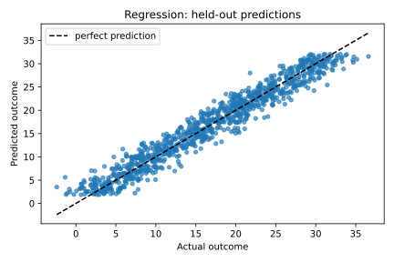

# Regression: a practical pathway

Predict a continuous quantity, such as cost or demand. Start with a mean baseline, then compare it with a tree on an independent test set.

**Path:** Define the decision → Prepare data → Fit a baseline → Evaluate → Inspect → Act and monitor.

## 1. Define the data and split

Each row contains one numeric feature, `volume`. The target is continuous. The example uses 2,000 synthetic training rows and 1,000 held-out rows. Production splits must respect time, customers, and other groups.

## 2. Fit and inspect a small example

This complete example uses the package and Python standard library. It uses synthetic data and a fixed seed. Run it from a Python environment with `mltreelib` installed.

```python
from random import Random
from mltreelib import Metrics, ModelTree

rng = Random(41)
x = [[rng.uniform(0, 10)] for _ in range(3000)]
y = [2 + 3 * row[0] + rng.gauss(0, 2) for row in x]
model = ModelTree(leaf="linear", max_depth=2, min_rows=20)
model.fit(x[:2000], y[:2000], col_names=["volume"])
pred = model.predict(x[2000:])
report = Metrics().regression(y[2000:], pred)
print("regression held-out RMSE:", round(report["rmse"], 3))
print("regression splits:", model.splits())
```

## 3. See the result



The figure comes from [`examples/modeling_pathways.py`](https://github.com/jkapila/mltreelib/blob/main/examples/modeling_pathways.py). Rendering the figures requires matplotlib. The example is a teaching illustration, not a benchmark.

## 4. Evaluate before deciding

The script reports held-out RMSE and named splits. Compare RMSE and MAE with a baseline, then inspect residuals by range and subgroup. Large errors can matter more than average error.

## 5. Interpret and monitor

Inspect `model.splits()` and leaf support. A linear leaf can extrapolate outside observed values. A split describes association, not the effect of changing a feature.

## Synthetic checks followed by real-data explanation

The [regression comparison](https://github.com/jkapila/mltreelib/blob/main/examples/regression_real_and_synthetic.py) first generates 5,000 records with raw category labels and 15% missing numeric inputs. It fits four `ModelTree` configurations on 3,000 rows, selects one using 1,000 validation rows, then checks it on 1,000 separate test rows. The test set contains 169 missing numeric values. No imputation or categorical encoder is applied.

```bash
uv run python examples/regression_real_and_synthetic.py
```

| Synthetic configuration | Validation RMSE |
|---|---:|
| Mean leaves, depth 2 | 3.594 |
| Mean leaves, depth 4 | 2.704 |
| Linear leaves, depth 2 | 2.624 |
| Linear leaves, depth 4 | 2.633 |

For this seed and simulated data, linear leaves at depth 2 had the lowest validation RMSE. Its test RMSE was 2.935, against 6.385 for a training-mean baseline. This chooses among four settings on one synthetic problem. It does not establish the best model for other datasets.


The same configuration then fits 6,000 rows from the real [OpenML diamonds dataset 46923](https://www.openml.org/d/46923) and predicts 2,000 separate rows. The data has 53,940 total records. Download its parquet file to `datasets/diamonds.parquet`; see the [dataset manifest](https://github.com/jkapila/mltreelib/blob/main/datasets/MANIFEST.md). The example needs pandas, pyarrow and matplotlib.

On the fixed random split, test RMSE was 1,381.867 versus 3,982.039 for the training-mean baseline. Test MAE was 772.555 versus 3,012.514. These values use the dataset's price units and describe this split, not a benchmark result. The selected real training columns contained no missing values, so the synthetic check supplies the missing-data exercise.

The real tree splits on named size measurements, including `x` and `y`, and exposes leaf support and coefficients. Inspect the feature definitions and leaf sample sizes before drawing business conclusions. Category values in fitted structures can appear as internal codes. Coefficients and paths describe the prediction model; they do not establish what happens if a business changes a feature.

## Next steps and references

[Model building](../examples/model-building.md) · [Inspection](../examples/inspection.md) · [Regression metrics](../reference/metrics.md)

Continue with [data preparation](data.md), [evaluation and monitoring](evaluation.md), or [model extensions](advanced-modeling.md). The [practical modeling pathways](index.md) show the other tasks. For broader coverage, see the [documentation audit](https://github.com/jkapila/mltreelib/tree/main/references/research).
