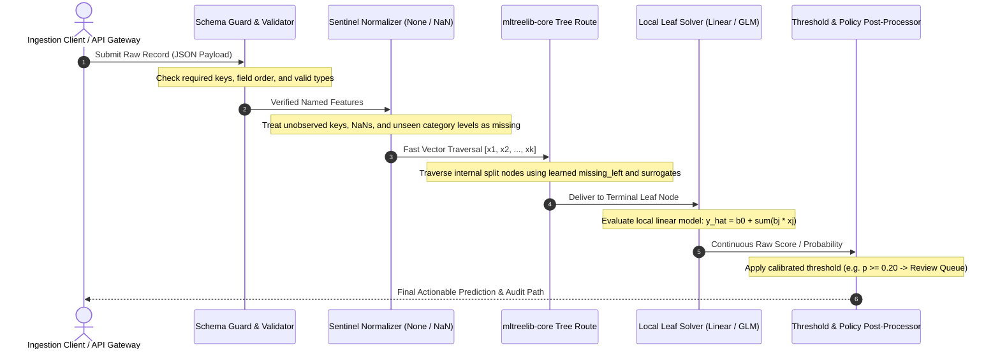

# Prepare a model for prediction

Record the fitted model's prediction contract, then save the model and check predictions after reloading.

## 1. Record the prediction contract

| Item | Record before handing off the model |
|---|---|
| Decision | Outcome, units, prediction horizon and when features are available. |
| Inputs | Feature names, order, types, units and allowed values. |
| Missingness | Which fields can be missing and how the fitted model routes them. |
| Categories | Training vocabulary and how the workflow handles an unseen value. |
| Output | Prediction kind, scale, class ordering and any decision threshold. |
| Evidence | Training data period, split, baseline, metrics and known model gaps. |



`ModelTree` accepts raw categorical strings and missing predictor values. Preserve the fitted feature order. A row-based input does not carry column names at prediction time, so your application needs to check the schema before constructing rows.

**Next:** section 2 applies that contract to a fitted model: it checks the field names against the fitted schema and builds each row in the fitted order.

## 2. Fit and predict with named records

The following example checks names before converting a record to the fitted order. It passes category labels and missing values directly to the tree.

<!-- run -->
```python
from mltreelib import ModelTree

names = ["region", "volume"]
dtypes = ["categorical", "numeric"]
x_train = [["north", 1.0], ["north", None], ["south", 1.0], ["south", None]] * 10
y_train = [1.0, 2.0, 9.0, 10.0] * 10
model = ModelTree(max_depth=2, min_rows=4, leaf="mean")
model.fit(x_train, y_train, col_names=names, dtypes=dtypes)

record = {"region": "north", "volume": None}
if set(record) != set(names):
    raise ValueError("Input fields do not match the model schema")
row = [record[name] for name in names]
print("Prediction:", model.predict([row])[0])
```

<!-- output -->
```text
Prediction: 1.5
```

Check types, units, ranges and batch sizes at the application boundary as well. The short example checks field names only. It does not provide a complete serving validator.

**Next:** section 3 saves the fitted model and reloads it, then checks that predictions still match the in-process result from section 2.

## 3. Persist a fitted model

`ModelTree.save()` writes a versioned UTF-8 JSON file. `ModelTree.load()` restores the fitted tree, including the state used for inference.

<!-- run -->
```python
from pathlib import Path
from tempfile import TemporaryDirectory

expected = model.predict([row])
with TemporaryDirectory() as directory:
    path = Path(directory) / "model.json"
    model.save(path)
    restored = ModelTree.load(path)
    assert restored.predict([row]) == expected
```

Use `model.to_json()` and `ModelTree.from_json(text)` for JSON strings. Use `model.to_bytes()` and `ModelTree.from_bytes(data)` when the transport requires bytes. The bytes contain the same JSON encoded in UTF-8. Standard Python pickle uses the same model state.

<!-- run -->
```python
import pickle

assert ModelTree.from_json(model.to_json()).predict([row]) == expected
assert ModelTree.from_bytes(model.to_bytes()).predict([row]) == expected
assert pickle.loads(pickle.dumps(model)).predict([row]) == expected
```

Persistence rejects Python callbacks in the model configuration. Keep the package version with each artifact and check predictions before upgrading the serving environment. Use `extract_rules()` for rule inspection and load pickle data only from trusted sources.

The artifact contains the training rows and targets retained for neighbor adjustments. Apply the same access controls you use for training data.

**Next:** section 4 lists the release checks, starting with a comparison of the in-process prediction against the intended serving path, which needs the reloaded model from section 3.

## 4. Checks before release

1. Compare a known in-process prediction with the intended serving path.
2. Check missing values, unseen categories, invalid types and changed column order.
3. Check the output scale and confirm the decision threshold uses independent validation data.
4. Record the model and package versions, data period and evaluation results.
5. Monitor input missingness, category changes, output distributions and observed outcomes.

The following gaps were reproduced in the current worktree and are tracked for investigation:

- A short or extra-long row was accepted in one test. Do not assume the model rejects a schema mismatch.
- An unseen category routed differently from a missing category in a tested tree, despite the stated unseen-as-missing rule.
- `break_down` rejected a raw string category in a tested row, although `predict` accepted it.

Do not present the checks above as complete deployment coverage. See the [data guide](data.md), [evaluation guide](evaluation.md), and [documentation audit](https://github.com/jkapila/mltreelib/tree/main/references/research) for further work.

**Next:** section 5 checks predictions on either side of a split threshold, which the release checks above do not cover, before a split is turned into an executable rule.

## 5. Check split boundaries

The DOT export in the checked build labels numeric branches as `<` and `>=`. In a one-feature reproduction with a threshold of zero, the fitted tree routed zero with lower values. It routed positive values to the other leaf. Use the fitted model to check predictions below, at, and above a threshold before translating a diagram into executable rules.

## Numerical reproducibility

Results are computed in IEEE 754 double precision and are reproducible to about 12 significant digits on the same platform, build, BLAS/LAPACK and thread settings. The test suite checks this at a relative tolerance of 1e-12. We make no guarantee of bit-identical output across operating systems, CPUs, BLAS or LAPACK implementations, thread counts or library versions; differences in the last digits are expected. Randomized procedures are reproducible given the same seed and RNG kind; the seed-to-stream mapping may change across versions.

- **Same inputs, same model file.** A saved model (`to_json`, `to_bytes`) holds no wall-clock timings, so refitting on identical data and settings on the same machine gives a byte-identical file. Total fit time is a diagnostic and is not part of the saved model.
- **Compare numbers, not printed text.** When you check a result against a stored one, use a relative tolerance (for example `abs(a - b) <= 1e-12 * max(1.0, abs(b))`), not string equality.
- **Missing values are part of the data.** Results with missing values follow the same rule; nothing is imputed.
