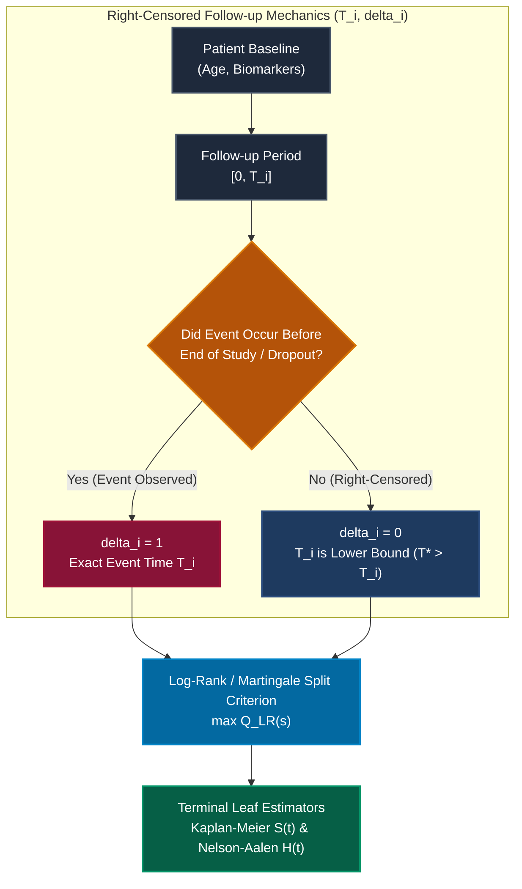
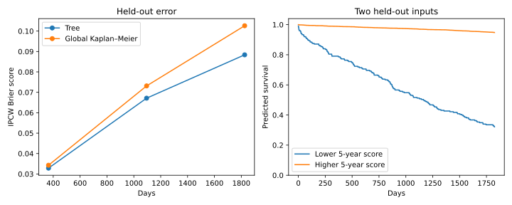
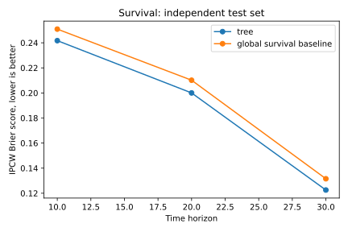

# Survival trees in Python: FLCHAIN mortality follow-up

Use baseline measurements to estimate survival at one, three and five years. The event is death. If follow-up ends first, the row is right-censored.

## 1. Get the data and define the evaluation

The `survival` package's [FLCHAIN cohort](https://cran.r-project.org/web/packages/survival/survival.pdf) contains 7,874 people and right-censored follow-up. `futime` is follow-up in days and `death=1` records a death. We use age, sex, kappa, lambda and creatinine as predictors. We exclude `chapter`, which describes cause of death and is unavailable at prediction time. Creatinine is missing for 952 of the 5,500 training records and 398 of the 2,374 test records; values enter the tree without imputation.

Download [FLCHAIN CSV from Rdatasets](https://vincentarelbundock.github.io/Rdatasets/csv/survival/flchain.csv) to `datasets/external/real_eval/flchain.csv`. The checked file SHA-256 is `a96bcc58addb4c127e5012c5974aec8c7daf66123ddb104f309a78f158daa563`. Run the shared [real-data evaluation script](https://github.com/jkapila/mltreelib/blob/main/examples/guides/real_survival_uplift.py).

```bash
uv run python examples/guides/real_survival_uplift.py survival
```

## 2. Fit leaf survival curves

`futime` is the time to death or last observation. Keep the event flag next to it. For example, someone censored at day 600 survived beyond day 365, but their status at day 1,095 is unknown. Do not replace the censored outcome with an event at day 600.



Run this Python block from the repository root. The evaluation helpers are part of the example script.

```python
from bisect import bisect_left, bisect_right
from collections import Counter
from random import Random

import pandas as pd
from mltreelib import ModelTree

def censor_km(times, events):
    """Censoring survival G(t), estimated from training observations."""
    counts = Counter(times)
    censored = Counter(t for t, event in zip(times, events) if not event)
    at_risk, steps, probs, g = len(times), [], [], 1.0
    for t in sorted(counts):
        g *= 1 - censored[t] / at_risk
        steps.append(t); probs.append(g); at_risk -= counts[t]
    def g_at(t, left=False):
        i = (bisect_left if left else bisect_right)(steps, t) - 1
        return 1.0 if i < 0 else probs[i]
    return g_at

def brier(times, events, predictions, horizon, censor):
    """IPCW Brier score at one horizon."""
    g_h = censor(horizon)
    total = 0.0
    for t, e, pred in zip(times, events, predictions):
        if t <= horizon and e:
            total += pred ** 2 / censor(t, left=True)
        elif t > horizon:
            total += (1 - pred) ** 2 / g_h
    return total / len(times)

df = pd.read_csv("datasets/external/real_eval/flchain.csv")
features = ["age", "sex", "kappa", "lambda", "creatinine"]
types = ["numeric", "categorical", "numeric", "numeric", "numeric"]
ids = list(range(len(df)))
Random(2026).shuffle(ids)

def inputs(indices):
    part = df.iloc[indices]
    x = [[None if pd.isna(v) else v for v in row]
         for row in part[features].itertuples(index=False, name=None)]
    return x, part.futime.astype(float).tolist(), part.death.astype(float).tolist()

x_train, t_train, e_train = inputs(ids[:5500])
x_test, t_test, e_test = inputs(ids[5500:])
grid = [365.0, 1095.0, 1825.0]
censor = censor_km(t_train, e_train)

for depth in (0, 2):
    tree = ModelTree(leaf_family="survival", max_depth=depth,
                     min_rows=100, prune="none")
    tree.fit(x_train, (t_train, e_train), col_names=features, dtypes=types)
    curves = tree.predict(x_test, kind="survival", times=grid)
    print("depth", depth, "first survival curve", curves[0])
    for j, horizon in enumerate(grid):
        print(horizon, brier(t_test, e_test, [curve[j] for curve in curves],
                             horizon, censor))
    print(tree.splits()[:1])
```

The depth-zero tree estimates one Kaplan–Meier curve for everyone. The deeper tree assigns a separate curve to each leaf. Inspect early and late horizons separately because each has a different set of known outcomes.

## 3. Interpret the held-out results

| Horizon, days | Test at risk | Censoring survival, training estimate | Tree IPCW Brier | Global baseline |
|---:|---:|---:|---:|---:|
| 365 | 2,270 | 0.9930 | 0.0329 | 0.0343 |
| 1,095 | 2,144 | 0.9834 | 0.0671 | 0.0731 |
| 1,825 | 2,043 | 0.9737 | 0.0884 | 0.1026 |



The right panel shows two held-out feature rows routed through the training tree. They were selected by their predicted five-year survival, without using their outcomes. Their five-year predictions are 0.321 and 0.948. These are leaf estimates. The left panel measures error across all 2,374 test rows, which include 644 recorded deaths and 1,730 censored observations over the available follow-up.

The example uses a seeded random split and estimates the marginal censoring distribution from training data only. A marginal censoring model assumes censoring is independent of the outcome in the relevant population. This observational cohort and one split do not establish clinical usefulness. Check conditional censoring, calibration, discrimination and uncertainty with the intended deployment population before interpreting the comparison.

## 4. Controlled check with synthetic truth

The [survival and uplift evaluation script](https://github.com/jkapila/mltreelib/blob/main/examples/guides/survival_uplift_evaluation.py) simulates 5,000 people. It fits 3,000 and evaluates 2,000 independent records, including 1,391 observed events and 609 censored observations. A global survival model provides the baseline.

```bash
uv run python examples/guides/survival_uplift_evaluation.py
```

| Horizon | Tree IPCW Brier | Global baseline IPCW Brier |
|---:|---:|---:|
| 10 | 0.2417 | 0.2509 |
| 20 | 0.2000 | 0.2102 |
| 30 | 0.1226 | 0.1316 |



The Brier score compares predicted survival probabilities with event outcomes at a fixed horizon. Inverse probability of censoring weights (IPCW) account for records censored before that horizon. Lower is better. This simulation uses the **known** censoring distribution. Real data requires a justified censoring model estimated without using the test outcomes for model selection, adequate follow-up, and positive censoring survival at each evaluated horizon. Conditional censoring requires appropriate conditional weights; a single global curve can be wrong.

The script also compares predictions with the known synthetic survival probability. Real individual survival probabilities are not observed. Check discrimination and horizon-specific calibration on real held-out data, with uncertainty and risk-set sizes. This example implements the evaluation calculation locally; it does not claim an IPCW metric API exists in the package. See [Graf et al. (1999)](https://doi.org/10.1002/(SICI)1097-0258(19990915/30)18:17/18%3C2529::AID-SIM274%3E3.0.CO;2-5).

## 5. Competing risks and multi-cause endpoints

When subjects can experience mutually exclusive event causes (e.g. disease relapse vs treatment-related mortality), treating competing events as ordinary censoring violates the independent censoring assumption and overestimates cumulative incidence by 20–50%.

`mltreelib` implements native competing risks trees:
- **Split Criterion**: Gray's subdistribution log-rank test (`gain="gray", target_cause=j`) maintaining subjects who experienced competing events in the risk set.
- **Leaf Estimators**: Aalen-Johansen multi-state estimator guaranteeing the probability simplex identity: $\sum_{c=1}^J \hat{F}_c(t) + \hat{S}(t) = 1.0$.
- **Unified Prediction API**: `tree.predict(X, kind="cif", times=times, cause=1)` and `tree.predict(X, kind="risk")`.
- **Validation**: `Metrics().competing_risks(...)` computing cause-specific Harrell's C, Uno's IPCW C-index, and time-dependent Brier score matrices.

```python
from mltreelib import ModelTree, Metrics

# Events: 0 = censored, 1 = relapse (primary), 2 = toxicity (competing)
tree = ModelTree(max_depth=3, min_rows=25, gain="gray", target_cause=1)
tree.fit(X_train, (durations_train, events_train))

# Evaluate Aalen-Johansen CIF at specified horizons
times = [2.0, 5.0, 10.0, 20.0]
cif_cause1 = tree.predict(X_test, kind="cif", times=times, cause=1)
cif_cause2 = tree.predict(X_test, kind="cif", times=times, cause=2)
surv = tree.predict(X_test, kind="survival", times=times)

# Compute full IPCW competing risks performance report
metrics = Metrics()
report = metrics.competing_risks(
    durations=durations_test,
    events=events_test,
    cif_curves={1: cif_cause1, 2: cif_cause2},
    times=times,
)
print("Cause 1 Harrell C:", report["cause_c_indices"][1])
print("Cause 1 Uno IPCW C:", report["cause_uno_c_indices"][1])
print("Cause 1 IBS:", report["cause_ibs"][1])
```

## Next steps and references

[Survival trees](../concepts/survival-trees.md) · [Kaplan and Meier (1958)](https://doi.org/10.1080/01621459.1958.10501452) · [Aalen (1978)](https://doi.org/10.1214/aos/1176344247) · [Gray (1988)](https://doi.org/10.1214/aos/1176350951)
