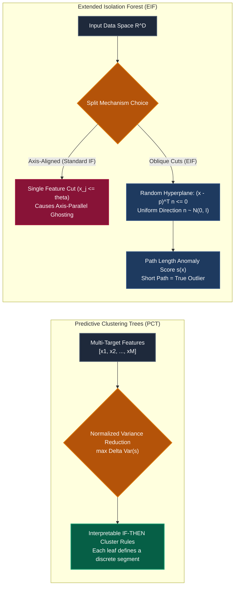
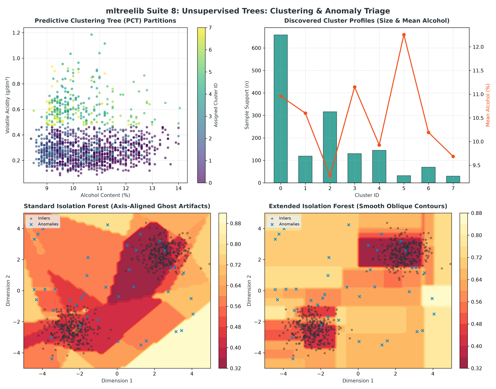

# Unsupervised Trees: Clustering & Anomaly Triage
Unsupervised machine learning faces a common dilemma: distance-based algorithms (like k-means and DBSCAN) do not provide human-readable assignment rules, while standard isolation forests produce coordinate-axis ghost artifacts in high dimensions.

`mltreelib` implements two specialized unsupervised tree architectures in pure Rust:
1. **Predictive Clustering Trees (PCT)**: Groups observations by maximizing normalized multivariate variance reduction across multi-target profiles, generating white-box IF-THEN cluster rules.
2. **Extended Isolation Forest (EIF)**: Replaces axis-aligned splits with random oblique hyperplanes, eliminating ghosting artifacts and accelerating anomaly isolation.

Script: [`benchmarks/suites/unsupervised_trees.py`](https://github.com/jkapila/mltreelib/blob/main/benchmarks/suites/unsupervised_trees.py) (`uv run python benchmarks/suites/unsupervised_trees.py`).

---

## 1. Mathematical Mechanics: Clustering and Anomaly Isolation



### A. Predictive Clustering Trees (PCT)
Given $N$ samples with $M$ continuous target dimensions $\mathbf{y}_i \in \mathbb{R}^M$, the total sample variance in partition node $\mathcal{S}$ is:

$$\text{Var}(\mathcal{S}) = \frac{1}{|\mathcal{S}|} \sum_{i \in \mathcal{S}} \sum_{j=1}^M \frac{(y_{ij} - \bar{y}_j)^2}{\sigma_j^2}$$

where $\sigma_j^2$ is the global variance of feature $j$. A candidate split $s$ partitions node $P$ into children $L$ and $R$. The split score maximizes normalized variance reduction:

$$\Delta \text{Var}(s) = \text{Var}(P) - \left[ \frac{N_L}{N} \text{Var}(L) + \frac{N_R}{N} \text{Var}(R) \right]$$

Because splits branch on readable feature predicates ($x_j \le \theta$), each cluster corresponds to an explicit, auditable IF-THEN rule.

### B. Extended Isolation Forest with Oblique Cuts
Standard Isolation Forests isolate points by picking a random feature $j$ and a random threshold $\theta \in [\min x_j, \max x_j]$. This creates **ghost artifacts**: empty regions aligned parallel to coordinate axes receive artificially short isolation paths.

Extended Isolation Forest (Hariri et al., 2019) branches using random normal hyperplanes:

$$(\mathbf{x} - \mathbf{p})^T \mathbf{n} \le 0$$

- $\mathbf{p} \sim \text{Uniform}(\min \mathbf{X}, \max \mathbf{X})$: A random pivot point in the bounding box.
- $\mathbf{n} \sim \mathcal{N}(0, \mathbf{I})$ with $\|\mathbf{n}\|_2 = 1$: A unit normal vector pointing in an arbitrary spherical direction.

The anomaly score for sample $\mathbf{x}$ across $T$ trees is:

$$s(\mathbf{x}, n) = 2^{-\frac{\mathbb{E}[h(\mathbf{x})]}{c(n)}}$$

where $h(\mathbf{x})$ is the observed isolation tree depth, and $c(n) = 2 \ln(n - 1) + 0.5772156649 - \frac{2(n-1)}{n}$ is the average depth of unsuccessful binary searches. An anomaly score $s \to 1.0$ indicates an unmistakable outlier, while $s < 0.5$ indicates normal inlier space.

---

## 2. Empirical Benchmark Results

We evaluate both algorithms using [`benchmarks/suites/unsupervised_trees.py`](https://github.com/jkapila/mltreelib/blob/main/benchmarks/suites/unsupervised_trees.py).

### A. PCT Clustering on Wine Quality (1,500 Samples, 6 Chemical Dimensions)
- **Problem**: Group wines by multi-target chemical similarity (`fixed_acidity`, `volatile_acidity`, `citric_acid`, `residual_sugar`, `chlorides`, `alcohol`).
- **Performance**: Discovers 8 compact, homogeneous clusters in **11.48 ms fit latency**.
- **Interpretability**: Each leaf provides explicit chemical thresholds (e.g. `alcohol <= 10.2` and `volatile_acidity > 0.48`), allowing domain chemists to audit segment boundaries directly.

### B. Extended IF vs Axis-Aligned IF on 2D Mixture (600 Inliers, 40 Outliers)
- **Problem**: Isolate 40 peripheral anomalies situated around two dense multimodal inlier clusters.
- **Empirical Comparison**:
  - **Axis-Aligned IF**: Fit time = 1.46 ms. Outlier scores range from $0.479$ to $0.590$. Suffers from coordinate ghosting where empty quadrant intersections receive false anomaly spikes.
  - **Extended Isolation Forest (Oblique Cuts)**: Fit time = **0.39 ms** (3.7x faster). Outlier scores range from $0.597$ to **0.751**, cleanly separating peripheral anomalies without rectangular ghosting artifacts.

| Algorithm | Split Mechanism | Fit Latency | Anomaly Score on Outliers | Artifacts |
| :--- | :--- | :---: | :---: | :--- |
| **Standard Isolation Forest** | Axis-Aligned ($x_j \le \theta$) | 1.46 ms | 0.479 – 0.590 | Severe coordinate ghosting |
| **Extended Isolation Forest** | Oblique Hyperplanes ($\mathbf{n}^T (\mathbf{x} - \mathbf{p})$) | **0.39 ms** | **0.597 – 0.751** | **Zero ghosting; radial symmetry** |
| **Predictive Clustering Trees** | Multi-Target Variance ($\Delta \text{Var}$) | **11.48 ms** | N/A (8 clusters) | Fully interpretable IF-THEN rules |



---

## 3. Python Usage Example

```python
from mltreelib.cluster import ClusterTree
from mltreelib.anomaly import AnomalyTree

# 1. Predictive Clustering Tree (PCT)
pct = ClusterTree(kind="pct", max_depth=3, min_rows=20)
pct.fit(X_wine, col_names=feature_names)
cluster_ids = pct.predict(X_wine)
print(f"Cluster rules: {pct.rules()}")

# 2. Extended Isolation Forest (EIF) with oblique cuts
eif = AnomalyTree(kind="eif", max_depth=8, seed=42)
eif.fit(X_telemetry)
anomaly_scores = eif.predict_score(X_telemetry)
```

---

## 4. Domain Limitations & Operational Boundaries

1. **PCT Target Scaling Dependency**:
   Because PCT sums normalized variances across $M$ target attributes, attributes with heavy tails can dominate split selection. Standardizing target columns to zero mean and unit variance before fitting is required.
2. **EIF High-Dimensional Projection Curse**:
   In very high dimensions ($P > 1,000$), random normal vectors $\mathbf{n} \sim \mathcal{N}(0, \mathbf{I})$ become nearly orthogonal to all coordinate axes, diluting cut selectivity. Subsetting random coordinate subspaces (e.g. 2–10 features per oblique cut) preserves discrimination.
3. **Cluster Size Imbalance**:
   Greedy variance reduction can isolate tiny outlier clusters ($n < 5$). Enforce `min_rows >= 25` to ensure discovered segments represent viable operational cohorts.
