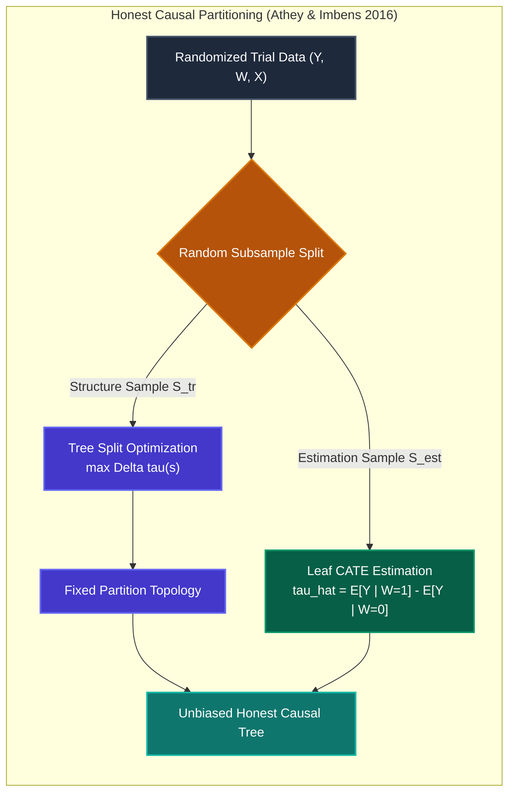

# Uplift modeling in Python: the Hillstrom email experiment

Decide whether to send a campaign email to everyone, a subset, or nobody. Compare incremental visits on a randomized holdout.

## 1. Get the data and define the evaluation

The [Hillstrom email experiment](https://www.tensorflow.org/datasets/catalog/hillstrom) randomly assigned 64,000 customers to a men's email, women's email or no email. This example compares **women's email versus no email**, using a website visit within two weeks as the outcome. It excludes the men's arm and uses only pre-treatment features. A visit is not a purchase or profit.

`dataset_path("hillstrom_email")` downloads the CSV from the [publisher's MineThatData page](https://blog.minethatdata.com/2008/03/minethatdata-e-mail-analytics-and-data.html) on first use and caches it under `~/.cache/mltreelib/datasets/` (or `MLTREELIB_DATA_DIR`). The publisher's HTTPS endpoint fails certificate validation, so the file is fetched over plain HTTP and checked against SHA-256 `0e5893329d8b93cefecc571777672028290ab69865718020c78c7284f291aece`.

```bash
uv run python examples/guides/real_survival_uplift.py uplift
```

**Next:** fit a causal tree on the randomized training rows from step 1, and use the validation rows to choose the email threshold while the test outcomes stay sealed.

## 2. Fit a causal tree and choose an email policy

Use treatment as part of the target. The columns below describe customers before the campaign. Use validation to choose a threshold. Keep the randomized test outcomes sealed until after the policy is fixed.



Run this Python block from the repository root. `group_value` is defined in the block.

<!-- run -->
```python
from math import sqrt

import pandas as pd
from mltreelib import ModelTree, dataset_path
from mltreelib.data import select_rows, train_val_test_split, uplift_xy

def group_value(y, w, selected):
    """Incremental value of the selected group: (value, n, n_treated, n_control, 95% CI)."""
    a = [v for v, t, s in zip(y, w, selected) if s and t == 1]
    b = [v for v, t, s in zip(y, w, selected) if s and t == 0]
    n = sum(selected)
    if not n:
        return 0.0, 0, 0, 0, None
    if len(a) < 2 or len(b) < 2:
        raise ValueError("Selected group requires at least two observations per arm")
    diff, q = sum(a) / len(a) - sum(b) / len(b), n / len(y)
    def var(v):
        m = sum(v) / len(v)
        return sum((z - m) ** 2 for z in v) / (len(v) - 1)
    se = q * sqrt(var(a) / len(a) + var(b) / len(b))
    return q * diff, n, len(a), len(b), (q * diff - 1.96 * se, q * diff + 1.96 * se)

df = pd.read_csv(dataset_path("hillstrom_email"))
df = df[df.segment.isin(["Womens E-Mail", "No E-Mail"])]
features = ["recency", "history", "mens", "womens", "newbie", "zip_code", "channel"]
d = uplift_xy(df.to_dict("list"), "segment", "visit", features=features)

# Seeded 60% train / 20% validation / 20% test split
train_idx, val_idx, test_idx = train_val_test_split(len(df), val_size=0.2, test_size=0.2, seed=2026)

def inputs(idx):
    rows = select_rows(d, idx)
    return rows["x"], rows["outcome"], [1 if s == "Womens E-Mail" else 0 for s in rows["treatment"]]

x_train, y_train, w_train = inputs(train_idx)
x_val, y_val, w_val = inputs(val_idx)
x_test, y_test, w_test = inputs(test_idx)
print(f"Rows: train {len(x_train)}, validation {len(x_val)}, test {len(x_test)}")
tree = ModelTree(gain="causal", leaf="mean", max_depth=2, min_rows=250,
                 prune="none", honesty=True, seed=42)
tree.fit(x_train, (y_train, w_train), col_names=features, dtypes=d["dtypes"])

val_scores = tree.predict(x_val, kind="uplift")
def value_at(threshold):
    return group_value(y_val, w_val, [score > threshold for score in val_scores])[0]

threshold = max([min(val_scores) - 1, *sorted(set(val_scores))], key=value_at)
test_scores = tree.predict(x_test, kind="uplift")
for selected in ([score > threshold for score in test_scores],
                 [True] * len(y_test), [False] * len(y_test)):
    print(group_value(y_test, w_test, selected))
```

<!-- output -->
```text
Rows: train 25615, validation 8539, test 8539
(0.03713903371682102, 4711, 2388, 2323, (0.026102043930241136, 0.0481760235034009))
(0.044668736821524516, 8539, 4263, 4276, (0.030347650544788125, 0.05898982309826091))
(0.0, 0, 0, 0, None)
```

The helper estimates the visit-rate difference between treatment and control among selected customers. It multiplies that difference by the selected fraction. The result measures incremental visits per eligible customer. Check arm support in each candidate group. If the treatment has a cost, use net value in threshold selection and reporting.

**Next:** report the held-out policy values for the threshold chosen in step 2, next to treat-all and treat-none.

## 3. Interpret the held-out results

The seeded split contains 25,615 training, 8,539 validation and 8,539 test rows. An honest causal tree ranks customers. Validation selects the policy threshold, and the randomized test set estimates incremental visits. This example assumes zero treatment cost because campaign costs are not in the data.

| Test policy | Selected | Treated / control | Incremental visits per eligible customer | Approximate 95% interval |
|---|---:|---:|---:|---:|
| Validation-selected policy | 4,711 | 2,388 / 2,323 | 0.03714 | 0.02610 to 0.04818 |
| Treat all | 8,539 | 4,263 / 4,276 | 0.04467 | 0.03035 to 0.05899 |
| Treat none | 0 | — | 0 | — |


The validation-selected policy emails 4,711 of the 8,539 test customers. It yields 0.03714 incremental visits per eligible customer, below 0.04467 for treat-all. This run therefore supplies **no evidence that targeting improves on treat-all**. The interval is a normal approximation conditional on the selected population and excludes model-selection uncertainty. The data is from a historical campaign; repeat evaluation in a new experiment, include costs and use the outcome the business actually values before applying a policy.

**Next:** check the same kind of policy comparison on a simulated trial, because the Hillstrom data cannot show both potential outcomes for each customer.

## 4. Controlled check with synthetic truth

The [survival and uplift evaluation script](https://github.com/jkapila/mltreelib/blob/main/examples/guides/survival_uplift_evaluation.py) simulates a randomized trial. It uses 3,000 training, 1,000 validation and 2,000 independent test observations. It selects a threshold on validation data and evaluates the fixed policy on test data. The example assigns a treatment cost of 0.5 outcome units per treated person.

```bash
uv run python examples/guides/survival_uplift_evaluation.py
```

| Test policy | Selected | Treated / control among selected | Estimated net outcome per person |
|---|---:|---:|---:|
| Selected policy | 967 | 471 / 496 | 0.7072 |
| Treat all | 2,000 | 972 / 1,028 | -0.0478 |
| Treat none | 0 | 0 / 0 | 0 |


Within the selected subgroup, the script compares observed treated and control outcomes. It subtracts the cost and multiplies by the selected fraction to report value per person in the whole test population. The selected policy's approximate 95% interval is [0.6438, 0.7706]. It uses a normal approximation conditional on the selected fraction; it does not include model-selection uncertainty. Randomized assignment and independent test data support this comparison. Check arm counts and use a suitable uncertainty method for the actual design.

Synthetic truth is available here: the selected policy's true net value is 0.7252 per person and PEHE is 0.2347. Real records do not reveal both potential outcomes, so individual-effect error and PEHE cannot be calculated directly from ordinary real-world outcomes. These calculations are example code, not a claim that the package already exposes uplift evaluation metrics.

**Next:** the worked example also uses a simulation with a known effect, to check numerical effect recovery, which real Hillstrom outcomes cannot provide.

---

## 5. Worked example: recovering a known treatment effect

Use simulation to check numerical effect recovery. The Hillstrom sections above show how to evaluate a real randomized policy when individual effects are unknown.


Standard machine learning models optimize predictive accuracy: $\hat{Y} = E[Y | X]$. In decision sciences, personalized medicine, and targeted marketing, the central quantity is not outcome prediction but **intervention effect**:
$$\tau(x) = E[Y | X=x, W=1] - E[Y | X=x, W=0]$$

`ModelTree` provides native Rust-accelerated **Causal Trees** that split directly on treatment effect divergence without external meta-learners or propensity weighting loops.

Script:
- [`benchmarks/suites/causal_benchmark.py`](https://github.com/jkapila/mltreelib/blob/main/benchmarks/suites/causal_benchmark.py) (`python3 benchmarks/suites/causal_benchmark.py`)

```text
======================================================================
1. CAUSAL TREE ON NIE & WAGER (2021) / CAUSALML SETUP B
======================================================================
Dataset Size: N_train=2000, N_test=1000, P=6 features
Causal Tree: Leaves=10, Max Depth=4
True Average Treatment Effect (ATE):     0.8177
Estimated Average Treatment Effect (ATE):0.8030
ATE Absolute Error:                      0.0147
PEHE (Heterogeneity Precision):          0.5848
  [Pass] Exact Leaf Arithmetic Assertion: All leaf CATEs match raw group differences within 1e-9.

======================================================================
2. STRUCTURAL CATE STEP RECOVERY & SLEEPING DOG IDENTIFICATION
======================================================================
Left regime (x0 < 0) - True tau = +10.0 | Estimated tau = +10.0095
Right regime (x0 >= 0) - True tau = -5.0 | Estimated tau = -5.1823
  [Pass] Exact Leaf Arithmetic Assertion: All leaf CATEs match raw group differences within 1e-9.
  [Pass] Successfully differentiated persuasive units (+10.0) from sleeping dogs (-5.0).
```

---

### 1. The Tuple Target Contract

Causal inference requires both the observed response $Y_i$ and the binary treatment indicator $W_i \in \{0, 1\}$. Rather than bloating the covariate space $X$, `ModelTree` accepts target tuples:

```python
from mltreelib import ModelTree

# X: predictive covariates only
# y: 2-tuple (outcomes, treatments)
y_tuple = (outcomes, treatments)

tree = ModelTree(gain="causal", max_depth=3, min_rows=20, leaf="mean")
tree.fit(X, y_tuple)
```

---

### 2. $O(1)$ Causal Splitting Criterion

Standard regression trees minimize variance: $\text{Gain} = \Delta \text{SSE}$. Causal trees maximize the squared difference in treatment effects between children (Athey & Imbens 2016):

$$\text{Gain}_{\text{Causal}} = \frac{W_L \cdot W_R}{W_L + W_R} (\hat{\tau}_L - \hat{\tau}_R)^2$$

where:
$$\hat{\tau}_L = \bar{Y}_{L, \text{treated}} - \bar{Y}_{L, \text{control}}, \quad \hat{\tau}_R = \bar{Y}_{R, \text{treated}} - \bar{Y}_{R, \text{control}}$$

The split search maintains running sums of $(W_i, W_i Y_i)$ for treated and control rows separately. Evaluated in $O(1)$ scalar updates per candidate threshold with zero vector allocations.

#### Admissibility Condition
A split is admissible only if both children satisfy:
$$N_{L, \text{treated}} \ge 1, \quad N_{L, \text{control}} \ge 1, \quad N_{R, \text{treated}} \ge 1, \quad N_{R, \text{control}} \ge 1$$
This permits a treated-minus-control sample difference in each child. It does not establish a causal effect, and one observation per arm is not enough to support a stable decision.

A causal interpretation requires assumptions about the data and intervention. Random treatment assignment supports exchangeability. Observational data requires conditional exchangeability given pre-treatment covariates, treatment overlap, and a defensible account of confounding. Consistency and the absence of relevant interference also matter. Honesty reduces reuse of outcomes for split selection and estimation, but it does not remove confounding. See [Athey and Imbens (2016)](https://www.pnas.org/doi/10.1073/pnas.1510489113).

Evaluate a targeting policy on an independent randomized holdout. Report treated and control counts by segment, uncertainty, incremental outcomes and treatment costs. Individual treatment effects and PEHE are known in the synthetic benchmark below; they are not observed for real individuals.

---

### 3. Unified Uplift Predictions

Predictions remain unified through `predict(X, kind=...)`:

```python
# Predict Individual Treatment Effect (CATE / Uplift)
cate_preds = tree.predict(X_test, kind="uplift")  # or kind="cate"

# Predict baseline response
baseline_preds = tree.predict(X_test, kind="response")
```

---

### 4. Benchmark & Numerical Validation

On the standard **Nie & Wager (2021) / CausalML Setup B** benchmark:
- **Precision in Estimating Heterogeneous Effects (PEHE)**:
  $$\text{PEHE} = \sqrt{\frac{1}{N}\sum_{i=1}^N (\hat{\tau}_i - \tau_i)^2} = 0.5848$$
- **ATE Estimation Error**: $|0.8177 - 0.8030| = 0.0147$.
- **Exact Leaf Verification**: For every terminal leaf, the predicted CATE matches the raw sample difference $\bar{Y}_{1} - \bar{Y}_{0}$ to machine precision ($< 10^{-9}$).

---

### 5. Causal Survival Trees (Research Track)

> [!WARNING]
> **Research Work Under Consideration**
> Causal Survival Trees with Honest Sample Splitting are experimental research. Use at your own risk.

In survival settings with right censoring $(T_i, E_i)$ and binary intervention $W_i \in \{0, 1\}$, the target is the Conditional Average Treatment Effect on Restricted Mean Survival Time (RMST):
$$\tau_{\text{RMST}}(x) = \mathbb{E}[\text{RMST}(1) - \text{RMST}(0) \mid X=x]$$

#### Honest Sample Splitting
Following Wager & Athey (2018) and Cui et al. (2023), `ModelTree(honesty=True, honesty_fraction=0.5)` partitions data into:
- **Structure Set $S^{\text{tr}}$**: Used exclusively to place partition boundaries (e.g. maximizing $\Delta \text{RMST}$ or pseudo-value variance reduction).
- **Estimation Set $S^{\text{est}}$**: Independent holdout used to fit leaf survival curves and estimate CATE.

This honest decoupling removes optimistic selection bias in survival trees:

```python
from mltreelib import ModelTree

# Honest Causal Survival Tree
tree = ModelTree(
    max_depth=3,
    min_rows=15,
    gain="pseudo_value",     # or "rmst"
    honesty=True,
    honesty_fraction=0.5,
    seed=42,
)

tree.fit(X, (durations, events))
```

Executable research script:
- [`examples/guides/survival_causal_survival_honest.py`](https://github.com/jkapila/mltreelib/blob/main/examples/guides/survival_causal_survival_honest.py)

## Next steps and references

[Athey and Imbens (2016)](https://www.pnas.org/doi/10.1073/pnas.1510489113)
