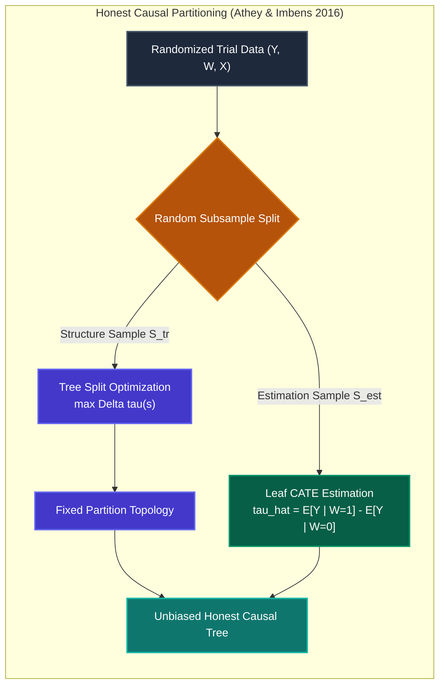
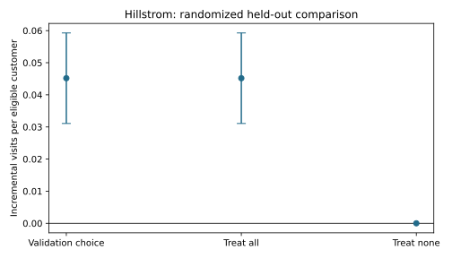
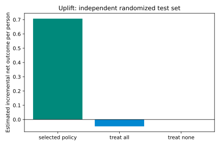

# Uplift modeling in Python: the Hillstrom email experiment

Decide whether to send a campaign email to everyone, a subset, or nobody. Compare incremental visits on a randomized holdout.

## 1. Get the data and define the evaluation

The [Hillstrom email experiment](https://www.tensorflow.org/datasets/catalog/hillstrom) randomly assigned 64,000 customers to a men's email, women's email or no email. This example compares **women's email versus no email**, using a website visit within two weeks as the outcome. It excludes the men's arm and uses only pre-treatment features. A visit is not a purchase or profit.

`dataset_path("hillstrom_email")` downloads the CSV from the [publisher's MineThatData page](https://blog.minethatdata.com/2008/03/minethatdata-e-mail-analytics-and-data.html) on first use and caches it under `~/.cache/mltreelib/datasets/` (or `MLTREELIB_DATA_DIR`). The publisher's HTTPS endpoint fails certificate validation, so the file is fetched over plain HTTP and checked against SHA-256 `0e5893329d8b93cefecc571777672028290ab69865718020c78c7284f291aece`.

```bash
uv run python examples/guides/real_survival_uplift.py uplift
```

**Next:** fit a causal tree on the randomized training rows from step 1, and use the validation rows to choose the email threshold while the test outcomes stay sealed.

## 2. Fit a causal tree and choose an email policy

Use treatment as part of the target. The columns below describe customers before the campaign. Use validation to choose a threshold. Keep the randomized test outcomes sealed until after the policy is fixed.



This snippet loads the Hillstrom CSV, wraps it in a `Dataset` with `outcome="visit"` and `treatment="treat"`, and makes a stratified 60% / 20% / 20% split (`train`, `val`, `test`). It fits an honest causal tree at `max_depth=4` (`min_rows=250`, `prune="none"`, `honesty=True`, `seed=42`). Note that **the causal leaf is always a difference of means ($\bar{Y}_1 - \bar{Y}_0$) whatever the `leaf` setting** (`leaf="linear"` produces the same leaf estimates under `gain="causal"`). It then calls `uplift_threshold` on `val` to pick the score cutoff and prints `MetricsReport("uplift", ...)` on `test`.

<!-- run -->
```python
import pandas as pd
from mltreelib import MetricsReport, ModelTree, dataset_path, uplift_threshold
from mltreelib.data import Dataset

df = pd.read_csv(dataset_path("hillstrom_email"))
df = df[df["segment"].isin(["Womens E-Mail", "No E-Mail"])].copy()
df["treat"] = (df["segment"] == "Womens E-Mail").astype(int)
features = ["recency", "history", "mens", "womens", "newbie", "zip_code", "channel"]

ds = Dataset(
    {k: df[k].tolist() for k in [*features, "treat", "visit"]},
    outcome="visit",
    treatment="treat",
    features=features,
    name="hillstrom_women",
)
train, val, test = ds.split(val_size=0.2, test_size=0.2, stratify=True, seed=2026)
print(f"Rows: train {train.n_rows}, validation {val.n_rows}, test {test.n_rows}")

tree = ModelTree(
    gain="causal", leaf="mean", max_depth=4, min_rows=250,
    prune="none", honesty=True, seed=42,
)
tree.fit(train)

val_scores = tree.predict(val, kind="uplift")
threshold = uplift_threshold(val.y, val.treatment, val_scores)
test_scores = tree.predict(test, kind="uplift")
rep = MetricsReport(
    "uplift",
    y_true=test.y,
    treatment=test.treatment,
    tau_pred=test_scores,
    threshold=threshold,
)
print(rep)
```

<!-- output -->
```text
Rows: train 25615, validation 8539, test 8539
Metrics report: uplift
======================

Inputs
------
  threshold  -0.01564

Rows per argument (n_missing = None/NaN):
  argument      n  n_missing
  y_true     8539          0
  treatment  8539          0
  tau_pred   8539          0

Overview
--------
  n_total                 8539
  n_treated               4278
  n_control               4261
  ate                  0.05314
  qini_coef              37.54
  qini_norm            0.07497
  auuc                   299.9
  top_decile_uplift    0.06752
  top_quintile_uplift  0.07457

Qini curve points:
  population_fraction     qini
                    0        0
            0.0001171        0
            0.0002342        0
            0.0003513        0
            0.0004684        0
            0.0005855        0
            0.0007027     -0.2
            0.0008198     -0.4
            0.0009369  -0.3333
             0.001054     -0.5
             0.001171  -0.4286
             0.001288   -0.375
             0.001405  -0.3333
             0.001522     -0.3
              0.00164  -0.2727
             0.001757  -0.3636
             0.001874  -0.4545
             0.001991  -0.4167
             0.002108      0.5
             0.002225   0.5385
  ... 8515 rows omitted; full table in .tables['qini_curve']
               0.9995    226.3
               0.9996    226.4
               0.9998    226.3
               0.9999    227.2
                    1    227.3

Cumulative gain points:
  population_fraction    gain
                    0       0
            0.0001171       0
            0.0002342       0
            0.0003513       0
            0.0004684      -1
            0.0005855      -1
            0.0007027    -1.2
            0.0008198    -1.4
            0.0009369  -1.333
             0.001054    -1.5
             0.001171  -1.429
             0.001288  -1.375
             0.001405  -1.333
             0.001522    -1.3
              0.00164  -1.273
             0.001757  -1.364
             0.001874  -1.455
             0.001991  -1.417
             0.002108     1.5
             0.002225   1.705
  ... 8515 rows omitted; full table in .tables['cumulative_gain']
               0.9995   451.7
               0.9996     452
               0.9998   451.7
               0.9999   453.5
                    1   453.7

Policy
------
  threshold  -0.01564

Policy comparison (selected: tau_pred > threshold; 95% normal CI):
  policy      n_selected  n_treated  n_control    value   ci_low  ci_high
  selected          8296       4158       4138  0.05281  0.03901  0.06662
  treat_all         8539       4278       4261  0.05314  0.03914  0.06714
  treat_none           0          0          0        0      n/a      n/a

Uplift by decile
----------------
Uplift by predicted-effect decile (decile 1 = highest):
  decile    n  n_treated  n_control  mean_tau_pred  mean_treated  mean_control    uplift
       1  853        431        422         0.1124        0.1508       0.08294   0.06787
       2  854        445        409        0.08946        0.1551       0.07335   0.08171
       3  854        412        442        0.08023        0.1772       0.09502   0.08216
       4  854        441        413        0.06509        0.2177        0.1114    0.1063
       5  854        426        428        0.06228        0.2136        0.1121    0.1015
       6  854        424        430        0.03101        0.1061       0.08837   0.01776
       7  854        439        415        0.02068        0.1162       0.08193   0.03425
       8  854        417        437        0.01189        0.1007       0.08924   0.01147
       9  854        424        430       0.007747        0.1651        0.1256   0.03951
      10  854        419        435      -0.003709        0.1146        0.1264  -0.01188
```

**What to read in the output:** `MetricsReport("uplift", ...)` reports four sections. `Overview` gives the overall ATE, Qini coefficient, normalized Qini, AUUC, top-decile uplift, and top-quintile uplift. `Policy` compares the validation-selected cutoff (`tau_pred > threshold`) against `treat_all` and `treat_none` by multiplying the treated-minus-control difference in the selected group by the selected population fraction, with approximate 95% normal confidence intervals. `Uplift by decile` ranks customers from highest predicted effect (decile 1) to lowest (decile 10) and shows the observed treated and control visit rates in each decile. If treatment has a cost, pass `cost=...` to both `uplift_threshold` and `MetricsReport`.

**Next:** report the held-out policy values for the threshold chosen in step 2, next to treat-all and treat-none.

## 3. Interpret the held-out results

The stratified seeded split contains 25,615 training, 8,539 validation and 8,539 test rows. An honest causal tree at depth 4 ranks customers. `uplift_threshold` selects the policy threshold (`-0.01564`) on validation data, and `MetricsReport` estimates incremental visits on the randomized test set. This example assumes zero treatment cost because campaign costs are not in the data.

| Test policy | Selected | Treated / control | Incremental visits per eligible customer | Approximate 95% interval |
|---|---:|---:|---:|---:|
| Validation-selected policy | 8,296 | 4,158 / 4,138 | 0.05281 | 0.03901 to 0.06662 |
| Treat all | 8,539 | 4,278 / 4,261 | 0.05314 | 0.03914 to 0.06714 |
| Treat none | 0 | 0 / 0 | 0 | — |



The validation-selected policy emails 8,296 of the 8,539 test customers. It yields 0.05281 incremental visits per eligible customer (95% CI 0.03901 to 0.06662), compared with 0.05314 (95% CI 0.03914 to 0.06714) for treat-all. With overlapping confidence intervals and a lower point estimate, this run supplies **no evidence that targeting improves on treat-all** at zero treatment cost. The interval is a normal approximation conditional on the selected population and excludes model-selection uncertainty. The data is from a historical campaign; repeat evaluation in a new experiment, include costs and use the outcome the business actually values before applying a policy.

**Next:** check the same kind of policy comparison on a simulated trial, because the Hillstrom data cannot show both potential outcomes for each customer.

## 4. Controlled check with synthetic truth

The [survival and uplift evaluation script](https://github.com/jkapila/mltreelib/blob/main/examples/guides/survival_uplift_evaluation.py) simulates a randomized trial. It uses 3,000 training, 1,000 validation and 2,000 independent test observations. It selects a threshold on validation data and evaluates the fixed policy on test data. The example assigns a treatment cost of 0.5 outcome units per treated person.

```bash
uv run python examples/guides/survival_uplift_evaluation.py
```

| Test policy | Selected | Treated / control among selected | Estimated net outcome per person |
|---|---:|---:|---:|
| Selected policy | 967 | 471 / 496 | 0.7072 |
| Treat all | 2,000 | 972 / 1,028 | -0.0478 |
| Treat none | 0 | 0 / 0 | 0 |



Within the selected subgroup, the script compares observed treated and control outcomes. It subtracts the cost and multiplies by the selected fraction to report value per person in the whole test population. The selected policy's approximate 95% interval is [0.6438, 0.7706]. It uses a normal approximation conditional on the selected fraction; it does not include model-selection uncertainty. Randomized assignment and independent test data support this comparison. Check arm counts and use a suitable uncertainty method for the actual design.

Synthetic truth is available here: the selected policy's true net value is 0.7252 per person and PEHE is 0.2347. Real records do not reveal both potential outcomes, so individual-effect error and PEHE cannot be calculated directly from ordinary real-world outcomes. For real-world evaluation, `MetricsReport("uplift", ...)` and `uplift_threshold(...)` provide the policy table and decile breakdown directly.

**Next:** the worked example also uses a simulation with a known effect, to check numerical effect recovery, which real Hillstrom outcomes cannot provide.

---

## 5. Worked example: recovering a known treatment effect

Use simulation to check numerical effect recovery. The Hillstrom sections above show how to evaluate a real randomized policy when individual effects are unknown.


Standard machine learning models optimize predictive accuracy: $\hat{Y} = E[Y | X]$. In decision sciences, personalized medicine, and targeted marketing, the central quantity is not outcome prediction but **intervention effect**:
$$\tau(x) = E[Y | X=x, W=1] - E[Y | X=x, W=0]$$

`ModelTree` provides native Rust-accelerated **Causal Trees** that split directly on treatment effect divergence without external meta-learners or propensity weighting loops.

Script:
- [`benchmarks/suites/causal_benchmark.py`](https://github.com/jkapila/mltreelib/blob/main/benchmarks/suites/causal_benchmark.py) (`python3 benchmarks/suites/causal_benchmark.py`)

```text
======================================================================
1. CAUSAL TREE ON NIE & WAGER (2021) / CAUSALML SETUP B
======================================================================
Dataset Size: N_train=2000, N_test=1000, P=6 features
Causal Tree: Leaves=10, Max Depth=4
True Average Treatment Effect (ATE):     0.8177
Estimated Average Treatment Effect (ATE):0.8030
ATE Absolute Error:                      0.0147
PEHE (Heterogeneity Precision):          0.5848
  [Pass] Exact Leaf Arithmetic Assertion: All leaf CATEs match raw group differences within 1e-9.

======================================================================
2. STRUCTURAL CATE STEP RECOVERY & SLEEPING DOG IDENTIFICATION
======================================================================
Left regime (x0 < 0) - True tau = +10.0 | Estimated tau = +10.0095
Right regime (x0 >= 0) - True tau = -5.0 | Estimated tau = -5.1823
  [Pass] Exact Leaf Arithmetic Assertion: All leaf CATEs match raw group differences within 1e-9.
  [Pass] Successfully differentiated persuasive units (+10.0) from sleeping dogs (-5.0).
```

---

### 1. The Tuple Target Contract

Causal inference requires both the observed response $Y_i$ and the binary treatment indicator $W_i \in \{0, 1\}$. Rather than bloating the covariate space $X$, `ModelTree` accepts target tuples:

```python
from mltreelib import ModelTree

# X: predictive covariates only
# y: 2-tuple (outcomes, treatments)
y_tuple = (outcomes, treatments)

tree = ModelTree(gain="causal", max_depth=3, min_rows=20, leaf="mean")
tree.fit(X, y_tuple)
```

---

### 2. $O(1)$ Causal Splitting Criterion

Standard regression trees minimize variance: $\text{Gain} = \Delta \text{SSE}$. Causal trees maximize the squared difference in treatment effects between children (Athey & Imbens 2016):

$$\text{Gain}_{\text{Causal}} = \frac{W_L \cdot W_R}{W_L + W_R} (\hat{\tau}_L - \hat{\tau}_R)^2$$

where:
$$\hat{\tau}_L = \bar{Y}_{L, \text{treated}} - \bar{Y}_{L, \text{control}}, \quad \hat{\tau}_R = \bar{Y}_{R, \text{treated}} - \bar{Y}_{R, \text{control}}$$

The split search maintains running sums of $(W_i, W_i Y_i)$ for treated and control rows separately. Evaluated in $O(1)$ scalar updates per candidate threshold with zero vector allocations.

#### Admissibility Condition
A split is admissible only if both children satisfy:
$$N_{L, \text{treated}} \ge 1, \quad N_{L, \text{control}} \ge 1, \quad N_{R, \text{treated}} \ge 1, \quad N_{R, \text{control}} \ge 1$$
This permits a treated-minus-control sample difference in each child. It does not establish a causal effect, and one observation per arm is not enough to support a stable decision.

A causal interpretation requires assumptions about the data and intervention. Random treatment assignment supports exchangeability. Observational data requires conditional exchangeability given pre-treatment covariates, treatment overlap, and a defensible account of confounding. Consistency and the absence of relevant interference also matter. Honesty reduces reuse of outcomes for split selection and estimation, but it does not remove confounding. See [Athey and Imbens (2016)](https://www.pnas.org/doi/10.1073/pnas.1510489113).

Evaluate a targeting policy on an independent randomized holdout. Report treated and control counts by segment, uncertainty, incremental outcomes and treatment costs. Individual treatment effects and PEHE are known in the synthetic benchmark below; they are not observed for real individuals.

---

### 3. Unified Uplift Predictions

Predictions remain unified through `predict(X, kind=...)`:

```python
# Predict Individual Treatment Effect (CATE / Uplift)
cate_preds = tree.predict(X_test, kind="uplift")  # or kind="cate"

# Predict baseline response
baseline_preds = tree.predict(X_test, kind="response")
```

---

### 4. Benchmark & Numerical Validation

On the standard **Nie & Wager (2021) / CausalML Setup B** benchmark:
- **Precision in Estimating Heterogeneous Effects (PEHE)**:
  $$\text{PEHE} = \sqrt{\frac{1}{N}\sum_{i=1}^N (\hat{\tau}_i - \tau_i)^2} = 0.5848$$
- **ATE Estimation Error**: $|0.8177 - 0.8030| = 0.0147$.
- **Exact Leaf Verification**: For every terminal leaf, the predicted CATE matches the raw sample difference $\bar{Y}_{1} - \bar{Y}_{0}$ to machine precision ($< 10^{-9}$).

---

### 5. Causal Survival Trees (Research Track)

> [!WARNING]
> **Research Work Under Consideration**
> Causal Survival Trees with Honest Sample Splitting are experimental research. Use at your own risk.

In survival settings with right censoring $(T_i, E_i)$ and binary intervention $W_i \in \{0, 1\}$, the target is the Conditional Average Treatment Effect on Restricted Mean Survival Time (RMST):
$$\tau_{\text{RMST}}(x) = \mathbb{E}[\text{RMST}(1) - \text{RMST}(0) \mid X=x]$$

#### Honest Sample Splitting
Following Wager & Athey (2018) and Cui et al. (2023), `ModelTree(honesty=True, honesty_fraction=0.5)` partitions data into:
- **Structure Set $S^{\text{tr}}$**: Used exclusively to place partition boundaries (e.g. maximizing $\Delta \text{RMST}$ or pseudo-value variance reduction).
- **Estimation Set $S^{\text{est}}$**: Independent holdout used to fit leaf survival curves and estimate CATE.

This honest decoupling removes optimistic selection bias in survival trees:

```python
from mltreelib import ModelTree

# Honest Causal Survival Tree
tree = ModelTree(
    max_depth=3,
    min_rows=15,
    gain="pseudo_value",     # or "rmst"
    honesty=True,
    honesty_fraction=0.5,
    seed=42,
)

tree.fit(X, (durations, events))
```

Executable research script:
- [`examples/guides/survival_causal_survival_honest.py`](https://github.com/jkapila/mltreelib/blob/main/examples/guides/survival_causal_survival_honest.py)

---

### 6. Customer IDs, Group Columns, and Leaf Membership

Pass `id_col` or `group_col` to `fit` (or set `group=` on `Dataset` for grouped splits) so identifiers are excluded from splitting (`train_ids=False`, `train_groups=False` by default). After fitting, `tree.leaf_samples(x, id_col=...)` maps each terminal leaf back to the customer IDs assigned to it.

<!-- run -->
```python
from mltreelib import ModelTree

rows = [
    ["c1", 25.0, 1.0], ["c2", 30.0, 0.0], ["c3", 45.0, 1.0], ["c4", 50.0, 0.0],
    ["c5", 22.0, 1.0], ["c6", 28.0, 0.0], ["c7", 48.0, 1.0], ["c8", 55.0, 0.0],
]
y = [12.0, 10.0, 20.0, 11.0, 11.5, 9.5, 21.0, 10.5]
arm = [1.0, 0.0, 1.0, 0.0, 1.0, 0.0, 1.0, 0.0]

tree = ModelTree(gain="causal", max_depth=2, min_rows=3)
tree.fit(rows, (y, arm), id_col="customer_id", col_names=["customer_id", "age", "active"])
print("Split columns:", [s["col"] for s in tree.splits()])
print("Leaf samples:", tree.leaf_samples(rows, id_col="customer_id", col_names=["customer_id", "age", "active"]))
```

<!-- output -->
```text
Split columns: ['age']
Leaf samples: {0: ['c1', 'c2', 'c5', 'c6'], 1: ['c3', 'c4', 'c7', 'c8']}
```

## Next steps and references

[Athey and Imbens (2016)](https://www.pnas.org/doi/10.1073/pnas.1510489113)
