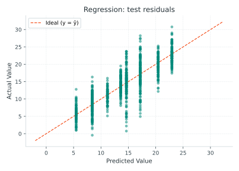
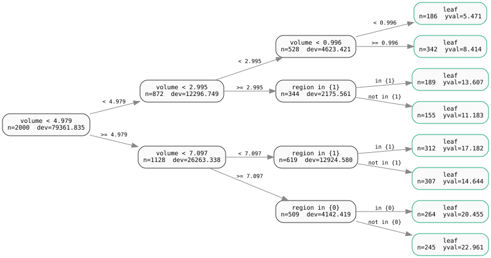
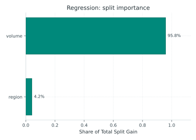
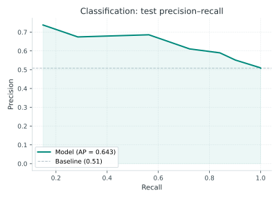
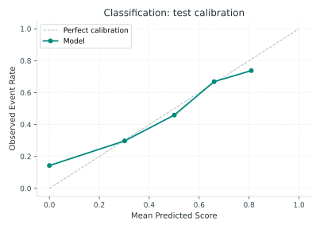
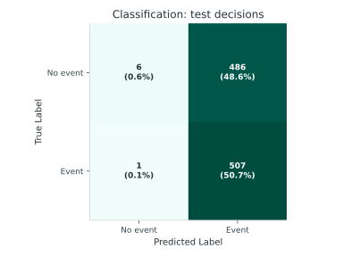
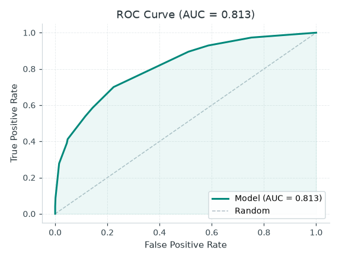
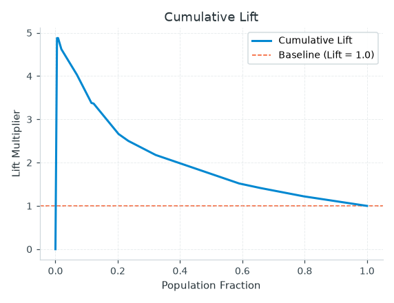
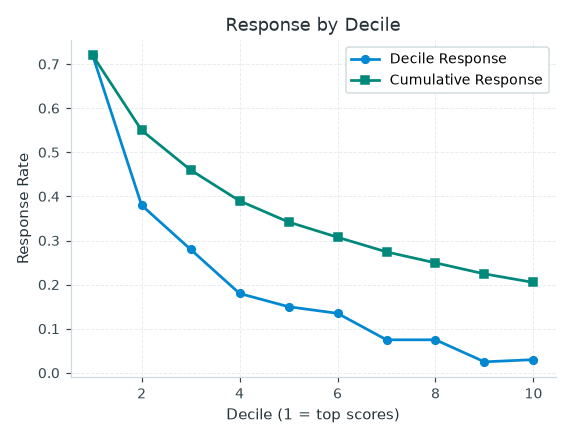
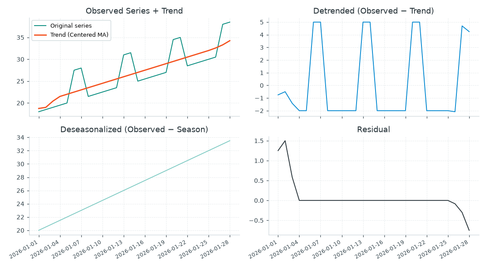

# Visualize data, model behavior and decisions

Use charts to answer a question at each step. The plots below come from the same reproducible [data and metrics example](https://github.com/jkapila/mltreelib/blob/main/examples/data_metrics_pathway.py). It uses synthetic mixed data, raw category labels and missing numeric inputs.

| Question | View | How to use it |
|---|---|---|
| Where are inputs missing? | Missingness counts | Compare fields, sources and time periods before deciding on data-quality work. |
| Where are numeric predictions wrong? | Residuals | Look for patterns and large errors on held-out observations. |
| How does a ranking trade precision for recall? | Precision–recall | Compare operating points with the event rate and review capacity. |
| Do predicted probabilities match outcomes? | Calibration | Compare predicted and observed rates, with bin counts and sample size. |
| What happens at the chosen threshold? | Confusion matrix | Read actual classes by row and predicted classes by column. |
| How does the fitted tree partition data? | Tree diagram and split importance | Review conditions, names, support and missing routing. |

## Reproduce the charts

```bash
uv run python examples/data_metrics_pathway.py
```

The script needs matplotlib and writes SVG files to `docs/assets/guides/`. It uses the existing `mltreelib.plots` functions for model diagnostics. Install the project plotting extra for those dependencies. To render the DOT tree, install the Graphviz `dot` executable. The numerical metrics and tree DOT representation do not require Graphviz.

## Use the plotting API

This complete example plots a small held-out regression result. The plotting layer is optional; `Metrics` returns numeric reports without matplotlib.

```python
import matplotlib.pyplot as plt
from mltreelib import Metrics, plots

actual = [1.0, 2.0, 3.0, 4.0]
predicted = [1.2, 1.8, 3.4, 3.7]
print("MAE:", Metrics().regression(actual, predicted)["mae"])
fig, ax = plt.subplots()
plots.plot_residuals(actual, predicted, ax=ax)
fig.tight_layout()
plt.close(fig)
```



## Read a tree and explain one row



`model.to_dot()` returns DOT text. Supply that text to Graphviz to render a diagram. `model.splits()` and `model.leaves()` expose structured information, while `model.break_down(row)` supports a path-based explanation for numeric rows. A test with raw string categories raised `TypeError` even though prediction accepted those rows. Mixed-category explanations are a product gap to investigate. Use [tree inspection](../examples/inspection.md) for examples. Verify category labels and missing routing before presenting a rule as actionable. A path explains a prediction; it does not by itself establish a causal intervention.



Split importance summarizes gain in a particular fitted tree. It is not a causal effect. Compare it with held-out errors and domain knowledge.

## Evaluate a classification decision







The [evaluation pathway](evaluation.md) explains the validation threshold, baseline and synthetic results. The catalog below covers the remaining plot functions.

## Complete plot catalog

The public `mltreelib.plots` module exposes the functions below. `y_true` is the observed outcome. `scores` are model scores for the positive class. Classification plots expect aligned binary outcomes and scores. Use held-out data for assessment. The linked images come from the earlier metrics showcase and are illustrative; run the showcase to regenerate them.

| Question | Function | View |
|---|---|---|
| How does ranking separate positives and negatives? | `plot_roc(y_true, scores)` | [ROC](../assets/plots/roc.png) |
| What precision accompanies each recall? | `plot_pr(y_true, scores)` | [Precision–recall](../assets/plots/pr.png) |
| How many events do the top-scored cases capture? | `plot_cumulative_gain(y_true, scores)` | [Cumulative gain](../assets/plots/gain.png) |
| How much better is targeting than the base event rate? | `plot_lift(y_true, scores)` | [Lift](../assets/plots/lift.png) |
| Where is class separation largest? | `plot_ks(y_true, scores)` | [KS](../assets/plots/ks.png) |
| How do outcome rates and capture vary by score band? | `plot_decile(y_true, scores, n_buckets=10)` | [Decile profile](../assets/plots/decile.png) |
| Do predicted probabilities agree with observed frequencies? | `plot_calibration(y_true, scores, n_bins=10)` | [Calibration](../assets/plots/calibration.png) |
| How does observed response vary by score band? | `plot_response(y_true, scores, n_buckets=10)` | [Response](../assets/plots/response.png) |
| How do two sets of predictions compare? | `plot_double_lift(y_true, scores_a, scores_b)` | [Double lift](../assets/plots/double_lift.png) |
| How did a score or numeric feature distribution change? | `plot_psi(reference, current, n_bins=10)` | [PSI](../assets/plots/psi.png) |
| What decisions were correct or incorrect? | `plot_confusion_matrix(confusion, class_names=None)` | [Confusion matrix](../assets/plots/confusion.png) |
| Where do numeric predictions miss? | `plot_residuals(y_true, y_pred)` | [Residuals](../assets/plots/residuals.png) |
| Which features contributed split gain? | `plot_importance(model.feature_importance())` | [Importance](../assets/plots/importance.png) |
| How does one prediction decompose along its path? | `plot_breakdown(model.break_down(row))` | [Break-down](../assets/plots/breakdown.png) |
| What signal components did the generator realize? | `plot_variance_shares(shares)` | [Variance shares](../assets/plots/variance_shares.png) |
| How does a series decompose? | `plot_decomposition(values, trend, detrended, deseason, residual, dates=None, axes=None)` | [Decomposition](../assets/plots/decomposition.png) |

A calibration plot is a diagnostic. It does not fit a probability calibrator or change model predictions. Fitted post-hoc calibration is on the roadmap.

The chart functions accept an optional Matplotlib `ax`; `plot_decomposition` uses `axes` for its panels. When using your own axes, use the axes you supplied rather than relying on a return value. See [`examples/metrics_showcase.py`](https://github.com/jkapila/mltreelib/blob/main/examples/metrics_showcase.py) for calls and chart generation. The [evaluation pathway](evaluation.md) explains how to choose a threshold and interpret held-out results.





