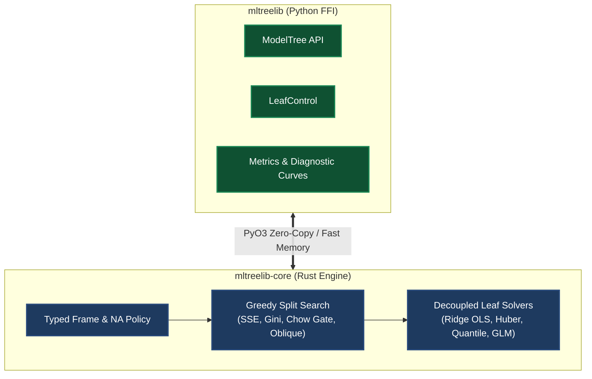

# mltreelib

<p align="center">
  <picture>
    <source media="(prefers-color-scheme: dark)" srcset="assets/mltreelib-logo-dark.svg">
    
  </picture>
</p>

**Tree-based machine learning with a Rust core.** A data & feature layer that
treats missing data as first-class, an adjustable benchmark generator with known
ground truth, and a tree learner that handles categoricals and missing values
natively — with rpart-faithful printing, SVG diagrams, and LightGBM-style
monotone & interaction constraints.

- Rust core (`mltreelib-core`), thin Python shell (PyO3)
- Scikit-learn-shaped API — without the scikit-learn dependency
- NA **and NaN** handled end-to-end: missing in → missing out; imputation opt-in
- 51 TabArena-v0.1 benchmark datasets on board, plus a generator whose knobs
  control how much signal lives in group and hierarchy structure

The canonical suite is documented in the [dataset manifest](benchmarks/datasets.md).
Use it to find each dataset's target, size, license, and OpenML source before
running a benchmark.

!!! tip "Optional agent skill"
    Install the repository skill separately from the Python package:
    `npx skills add jkapila/mltreelib --skill mltreelib`. See the
    [public skill source](https://github.com/jkapila/mltreelib/tree/main/skills/mltreelib).

<p align="center">
  
</p>



```bash
uv sync                                          # venv + Rust extension (maturin)
uv run python examples/quickstart.py             # fit, print, visualize (34.3% RMSE reduction on Concrete)
uv run python examples/real_tree_studies.py wine  # after downloading Wine Quality
```

| I want to… | go to |
|---|---|
| install it | [Installation](installation.md) |
| check the current release | [v0.4.14 release notes](https://github.com/jkapila/mltreelib/releases/tag/v0.4.14) |
| see it work in 30 seconds | [Quickstart](quickstart.md) |
| run 11 benchmark suites | [Benchmark Suites](suites/index.md) |
| choose a modeling task | [Practical modeling pathways](guides/index.md) |
| solve a real problem | [Real datasets and worked studies](guides/real-data.md) |
| change one part of a model | [Example library](examples/index.md) |
| wrangle data & encodings | [Examples — Data Processing](examples/data-processing.md) |
| know every knob | [Examples — Model building & predictions](examples/model-building.md) |
| read the numbers | [Examples — Inspection](examples/inspection.md) |
| draw the tree | [Visualization](guides/visualization.md) |
| see how it compares | [Overall Elo Arena](benchmarks/elo_overall.md) |
| read technical deep dives & blogs | [Blog & Technical Insights](blog/index.md) |
| look up every parameter | [API reference](reference/model.md) |

---

## Featured Technical Articles

Explore our in-depth architectural and commercial case studies:

1. **[Prescriptive Analytics: Predict-then-Optimize Inventory Replenishment](blog/prescriptive-inventory-replenishment.md)**
   *Supply Chain Optimization*: Predict-then-optimize multi-item replenishment using ModelTree per-leaf quantile curves and dual search optimization under warehouse capacity and working capital caps.
2. **[Segregate First, Model Later: Two-Stage Hierarchical Survival Trees](blog/segregate-first-two-stage-survival-trees.md)**
   *Actuarial & Retention Analytics*: How decoupling ID-level cohort discovery from leaf-level Kaplan-Meier curves eliminates right-censoring bias and non-proportional hazard violations.
3. **[Decision Trees for Credit Scoring](blog/why-credit-scoring-needs-glass-box-trees.md)**
   *Regulatory Compliance & Fintech*: Path-level auditing, monotone constraints, and probability calibration under fair lending rules.
4. **[Uplift Modeling with Causal Trees](blog/uplift-modeling-with-causal-trees.md)**
   *Commercial Decision Optimization*: Honest sample-splitting ($S^{\text{tr}}$ vs $S^{\text{est}}$) to identify persuadable customers without sleeping-dog harm.
5. **[Zero-Imputation Predictive Maintenance for Industrial Sensor Feeds](blog/zero-imputation-predictive-maintenance.md)**
   *Industrie 4.0 & Sensor Telemetry*: Native missing-data routing and surrogate splitting under severe asymmetric misclassification costs ($10 vs $500).

!!! tip "Try it right now"
    `uv run python examples/quickstart.py` fits a tree, prints it in rpart
    format and writes an SVG diagram. The end-to-end walkthrough then does the same on
    10,000 real bank customers.

The research program, roadmap and contribution rules live in the repository
(`README.md`, `AGENTS.md`).
