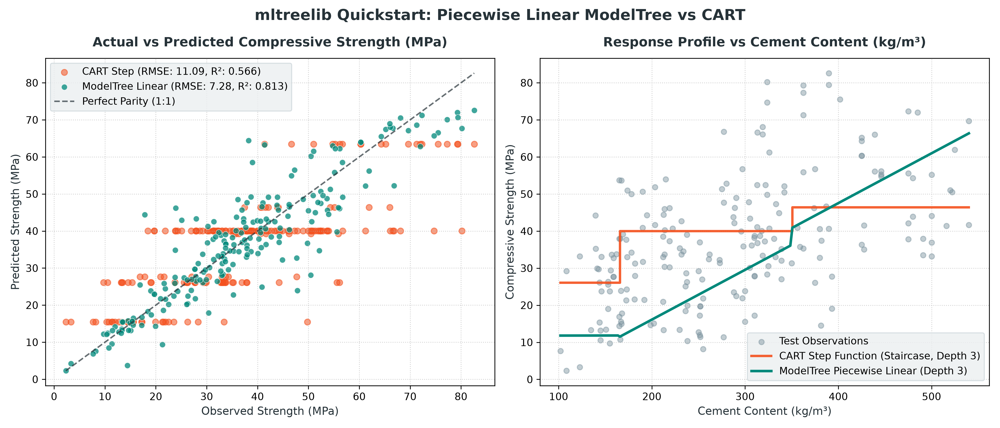
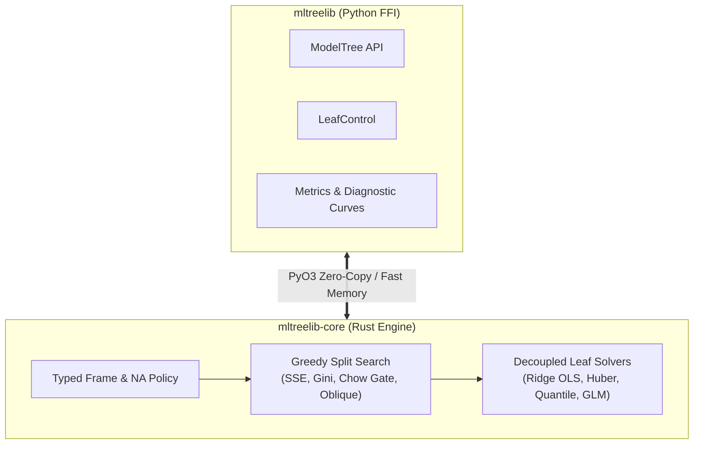

# mltreelib

<p align="center">
  <picture>
    <source media="(prefers-color-scheme: dark)" srcset="assets/mltreelib-logo-dark.svg">
    
  </picture>
</p>

**Tree-based machine learning with a Rust core.** A data & feature layer that
treats missing data as first-class, an adjustable benchmark generator with known
ground truth, and a tree learner that handles categoricals and missing values
natively — with rpart-faithful printing, SVG diagrams, and LightGBM-style
monotone & interaction constraints.

- Rust core (`mltreelib-core`), thin Python shell (PyO3)
- Scikit-learn-shaped API — without the scikit-learn dependency
- NA **and NaN** handled end-to-end: missing in → missing out; imputation opt-in
- 51 TabArena-v0.1 benchmark datasets on board, plus a generator whose knobs
  control how much signal lives in group and hierarchy structure

<p align="center">
  
</p>



```bash
uv sync                                          # venv + Rust extension (maturin)
uv run python examples/quickstart.py             # fit, print, visualize (34.3% RMSE reduction on Concrete)
uv run python examples/real_tree_studies.py wine  # after downloading Wine Quality
```

| I want to… | go to |
|---|---|
| install it | [Installation](installation.md) |
| see it work in 30 seconds | [Quickstart](quickstart.md) |
| choose a modeling task | [Practical modeling pathways](guides/index.md) |
| solve a real problem | [Real datasets and worked studies](guides/real-data.md) |
| change one part of a model | [Example library](examples/index.md) |
| wrangle data & encodings | [Examples — Data Processing](examples/data-processing.md) |
| know every knob | [Examples — Model building & predictions](examples/model-building.md) |
| read the numbers | [Examples — Inspection](examples/inspection.md) |
| draw the tree | [Visualization](guides/visualization.md) |
| see how it compares | [Benchmarks — ELO](benchmarks/elo.md) |
| read technical deep dives & blogs | [Blog & Technical Insights](blog/index.md) |
| look up every parameter | [API reference](reference/model.md) |

---

## Featured Technical Articles

Explore our in-depth architectural and commercial case studies:

1. **[Decision Trees for Credit Scoring](blog/why-credit-scoring-needs-glass-box-trees.md)**
   *Regulatory Compliance & Fintech*: How tree paths, constraints and calibration support model review.
2. **[Zero-Imputation Predictive Maintenance for Industrial Sensor Feeds](blog/zero-imputation-predictive-maintenance.md)**
   *Industrie 4.0 & Sensor Telemetry*: A synthetic example of missing sensor values and tree routing.
3. **[Uplift Modeling with Causal Trees](blog/uplift-modeling-with-causal-trees.md)**
   *Commercial Decision Optimization*: How an honest causal tree compares targeting policies on a randomized held-out trial.
4. **[Cubist Models and C5.0 Rules](blog/modernizing-quinlan-classics-in-rust.md)**
   *Core Systems ML*: Linear leaves, extracted rules and the contracts still to check.
5. **[Beyond Mean Squared Error: Distributional Decision Trees for Heavy Tails, Insurance, and Censored Data](blog/beyond-mse-distributional-trees.md)**
   *Actuarial & Risk Modeling*: Tweedie compound Poisson-Gamma claims, Tobit censored log-likelihood, and heteroscedastic volatility regimes.
6. **[Breaking the Step Function: Model Trees and Step Functions for Continuous Regression](blog/breaking-step-functions-model-trees-vs-gbdt.md)**
   *Systems ML & Physics-Informed ML*: How linear leaves represent local trends and why fair comparisons need held-out data.
7. **[Segregate First, Model Later: Two-Stage Hierarchical Survival Trees for Longitudinal Cohorts](blog/segregate-first-two-stage-survival-trees.md)**
   *Actuarial & Retention Analytics*: How decoupling ID-level cohort discovery from leaf-level Kaplan-Meier curves eliminates right-censoring bias and non-proportional hazard violations.

!!! tip "Try it right now"
    `uv run python examples/quickstart.py` fits a tree, prints it in rpart
    format and writes an SVG diagram. The end-to-end walkthrough then does the same on
    10,000 real bank customers.

The research program, roadmap and contribution rules live in the repository
(`README.md`, `AGENTS.md`).
