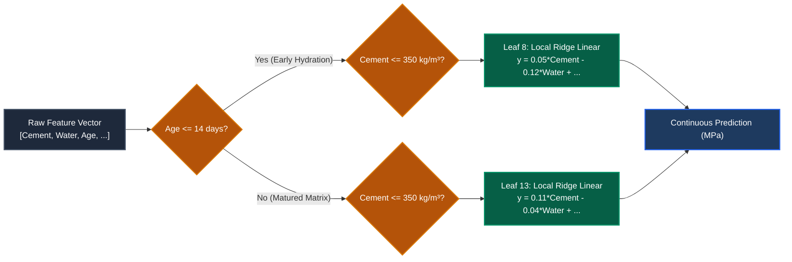
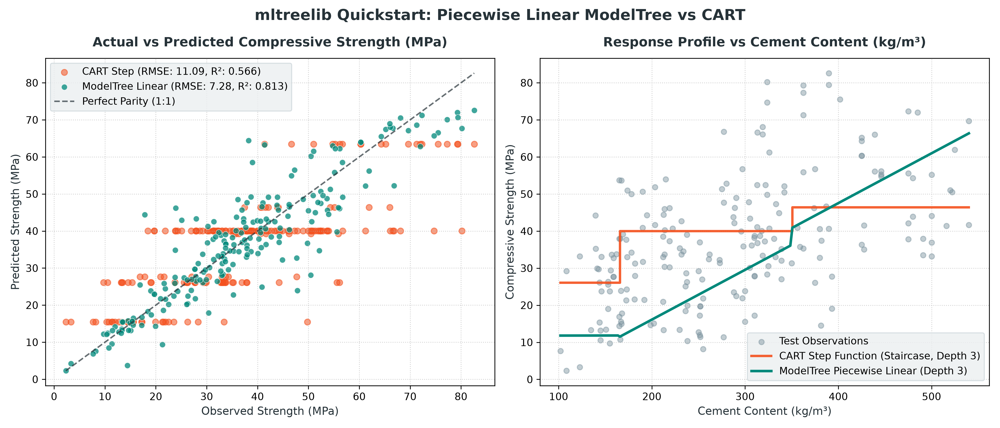
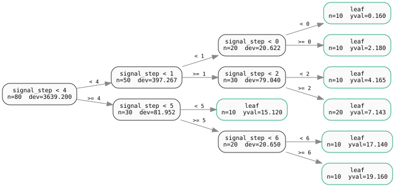

# Quickstart

Fit a high-performance model tree on real tabular data in seconds, inspect its transparent decision paths, and evaluate how piecewise linear leaves eliminate step-function distortion.

The complete executable script lives at [`examples/quickstart.py`](https://github.com/jkapila/mltreelib/blob/main/examples/quickstart.py):

```bash
uv run python examples/quickstart.py
```

---

## 1. Why Model Trees Outperform Standard CART

Standard decision trees (CART) predict a constant mean in each leaf node. On continuous tabular surfaces, this creates rigid staircase artifacts that require excessive depth and overfitting to approximate simple linear trends.

`ModelTree(leaf="linear")` decouples the tree partition search from leaf estimation. The tree discovers optimal split thresholds while terminal leaves fit regularized linear ridge regressions, capturing local slopes smoothly at shallow depth.



---

## 2. Fit and Evaluate on Real Benchmark Data

We evaluate on the industrial benchmark **Concrete Compressive Strength** (Yeh 1998[^1]; 1,030 mixtures, 8 continuous ingredients).

!!! tip "Why Decouple Tree Search from Leaf Estimation?"
    Evaluating multivariate linear models at every candidate split threshold incurs massive combinatorial overhead. `ModelTree` uses fast variance or structural break heuristics to discover partition boundaries, then solves the closed-form regularized ridge system once per terminal leaf node.

??? info "Dataset Provenance: Concrete Compressive Strength"
    Collected by Prof. I-Cheng Yeh (1998) at Chung-Hua University[^1]. Features 1,030 lab mixtures quantifying how 7 cementitious ingredient ratios (cement, slag, fly ash, water, superplasticizer, coarse aggregate, fine aggregate) and curing age interact nonlinearly to determine compressive yield stress (MPa).

=== "ModelTree (Linear Ridge)"

    ```python
    from mltreelib import Metrics, ModelTree, load_dataset

    # 1. Load benchmark dataset (1,030 mixtures, 8 features)
    data = load_dataset("concrete_compressive_strength")
    target = "ConcreteCompressiveStrength"
    feature_names = [col for col in data["columns"].keys() if col != target]
    n_rows = data["n_rows"]

    X = [[data["columns"][c][i] for c in feature_names] for i in range(n_rows)]
    y = data["columns"][target]

    # 80/20 train/test split
    split_idx = int(n_rows * 0.8)
    X_train, y_train = X[:split_idx], y[:split_idx]
    X_test, y_test = X[split_idx:], y[split_idx:]

    # Fit mltreelib ModelTree (piecewise linear ridge leaves, depth=3)
    model_tree = ModelTree(leaf="linear", max_depth=3, min_rows=20, l2=1e-3)
    model_tree.fit(X_train, y_train, col_names=feature_names)
    pred_mt = model_tree.predict(X_test)

    # Measure holdout metrics
    metrics = Metrics()
    m_mt = metrics.regression(y_test, pred_mt)
    print(f"ModelTree (Linear): RMSE = {m_mt['rmse']:.2f} MPa, R2 = {m_mt['r2']:.3f}, MAE = {m_mt['mae']:.2f} MPa")
    ```

!!! example "Output of `examples/quickstart.py`"

    ```text
    --8<-- "docs/snippets/outputs/quickstart.txt"
    ```

=== "ModelTree(leaf='mean') Baseline"

    ```python
    from mltreelib import Metrics, ModelTree, load_dataset

    data = load_dataset("concrete_compressive_strength")
    target = "ConcreteCompressiveStrength"
    feature_names = [col for col in data["columns"].keys() if col != target]
    n_rows = data["n_rows"]

    X = [[data["columns"][c][i] for c in feature_names] for i in range(n_rows)]
    y = data["columns"][target]

    split_idx = int(n_rows * 0.8)
    X_train, y_train = X[:split_idx], y[:split_idx]
    X_test, y_test = X[split_idx:], y[split_idx:]

    # Fit piecewise-constant CART decision tree (leaf="mean", depth=3)
    cart = ModelTree(leaf="mean", max_depth=3, min_rows=20)
    cart.fit(X_train, y_train, col_names=feature_names)
    pred_cart = cart.predict(X_test)

    metrics = Metrics()
    m_cart = metrics.regression(y_test, pred_cart)
    print(f"ModelTree (Mean)  : RMSE = {m_cart['rmse']:.2f} MPa, R2 = {m_cart['r2']:.3f}, MAE = {m_cart['mae']:.2f} MPa")
    ```

---

## 3. Empirical Results & Performance Comparison

```text
Loaded Concrete Compressive Strength: 1030 rows, 8 features.
Train rows: 824, Test rows: 206

=== Model Performance on Test Set ===
ModelTree (leaf="mean", d=3)    : RMSE = 11.09 MPa, R2 = 0.566, MAE = 8.47 MPa
sklearn DecisionTreeRegressor   : RMSE = 10.92 MPa, R2 = 0.579, MAE = 8.36 MPa
mltreelib ModelTree (Linear)    : RMSE =  7.28 MPa, R2 = 0.813, MAE = 5.07 MPa
--> Error reduction with linear leaves: 34.3%
```

| Model | Leaf Formulation | Depth | Test RMSE (MPa) | Test $R^2$ | Test MAE (MPa) |
|---|---|:---:|:---:|:---:|:---:|
| **`ModelTree(leaf="mean")`** | Constant Mean | 3 | 11.09 | 0.566 | 8.47 |
| **`sklearn.tree.DecisionTreeRegressor`** | Constant Mean | 3 | 10.92 | 0.579 | 8.36 |
| **`mltreelib` ModelTree (Linear)** | Regularized Linear Ridge | 3 | **7.28** | **0.813** | **5.07** |

With identical tree topology (depth 3, 8 leaves), `ModelTree` with linear leaves achieves a **34.3% error reduction** over constant-leaf CART baselines, elevating explained variance from ~57% to 81.3%.



- **Left Panel (Parity Plot)**: Predictions from `ModelTree(leaf="linear")` cluster tightly along the 1:1 diagonal, whereas constant-mean trees are constrained to horizontal bands corresponding to leaf averages.
- **Right Panel (Response Profile)**: Along the gradient of Cement content, constant-mean CART trees produce wide step discontinuities, while `ModelTree` preserves the physical continuous response curve.

---

## 4. Transparent Tree Structure & Inspection

`ModelTree` prints in `rpart`-compatible notation with exact node numbering, split criteria, sample support, deviance, and fitted constants:

```text
n= 824 

node), split, n, deviance, yval
      * denotes terminal node

 1) root 824 228333.917 35.46173  
   2) Age <= 14 263 38269.292 22.98684  
     4) Cement <= 350 190 14043.474 18.46968  
       8) Age <= 7 143 6493.479 15.44493 *
       9) Age > 7 47 2261.042 27.67263 *
     5) Cement > 350 73 10258.391 34.74381  
      10) Water <= 178 48 5059.180 39.25437 *
      11) Water > 178 25 2347.636 26.08354 *
   3) Age > 14 561 129948.081 41.31003  
     6) Cement <= 350 430 68793.496 36.74539  
      12) Cement <= 164.6 101 8521.781 26.09900 *
      13) Cement > 164.6 329 45309.403 40.01374 *
     7) Cement > 350 131 22786.202 56.29321  
      14) Water <= 181.1 76 6496.752 63.46522 *
      15) Water > 181.1 55 6978.299 46.38280 *
```

Export directly to Graphviz DOT for vector diagrams:

```python
dot_code = model_tree.to_dot()
```



---

## Next Steps

- Explore the **[Practical Modeling Pathways](guides/index.md)** for end-to-end classification, survival, and uplift workflows.
- Study **[Dynamic Leaf Retraining](guides/hierarchical-retrain.md)** for fast warm-start leaf adaptation.
- Review **[Distributional Leaves](guides/distributional-leaves.md)** for Tobit, Tweedie, and Gamma modeling.
- Inspect the **[API Reference](reference/model.md)** for all parameters and methods.

---

## References

[^1]: Yeh, I-C. (1998). "Modeling of strength of high-performance concrete using artificial neural networks." *Cement and Concrete Research*, 28(12), 1797-1808.
[^2]: Quinlan, J. R. (1992). "Learning with continuous classes." *5th Australian Joint Conference on Artificial Intelligence*, 343-348.
[^3]: Chow, G. C. (1960). "Tests of equality between sets of coefficients in two linear regressions." *Econometrica*, 28(3), 591-605.
