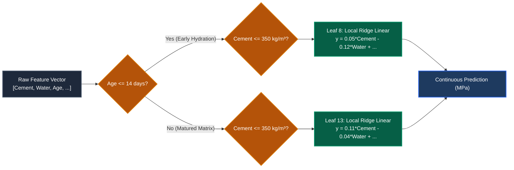

# Quickstart

Fit a high-performance model tree on real tabular data in seconds, inspect its transparent decision paths, and evaluate how piecewise linear leaves eliminate step-function distortion.

The complete executable script lives at [`examples/quickstart.py`](https://github.com/jkapila/mltreelib/blob/main/examples/quickstart.py):

```bash
uv run python examples/quickstart.py
```

---

## 1. Why Model Trees Outperform Standard CART

Standard decision trees (CART) predict a constant mean in each leaf node. On continuous tabular surfaces, this creates rigid staircase artifacts that require excessive depth and overfitting to approximate simple linear trends.

`ModelTree(leaf="linear")` decouples the tree partition search from leaf estimation. The tree discovers optimal split thresholds while terminal leaves fit regularized linear ridge regressions, capturing local slopes smoothly at shallow depth.



---

## 2. Fit and Evaluate on Real Benchmark Data

We evaluate on the industrial benchmark **Concrete Compressive Strength** (Yeh 1998[^1]; 1,030 mixtures, 8 continuous ingredients).

!!! tip "Why Decouple Tree Search from Leaf Estimation?"
    Evaluating multivariate linear models at every candidate split threshold incurs massive combinatorial overhead. `ModelTree` uses fast variance or structural break heuristics to discover partition boundaries, then solves the closed-form regularized ridge system once per terminal leaf node.

??? info "Dataset Provenance: Concrete Compressive Strength"
    Collected by Prof. I-Cheng Yeh (1998) at Chung-Hua University[^1]. Features 1,030 lab mixtures quantifying how 7 cementitious ingredient ratios (cement, slag, fly ash, water, superplasticizer, coarse aggregate, fine aggregate) and curing age interact nonlinearly to determine compressive yield stress (MPa).

This example loads the concrete strength dataset into a `Dataset`, splits it into an 80% training set and a 20% holdout set in row order, fits a `ModelTree` with linear ridge leaves at depth 4, and prints `MetricsReport`. Compare the linear-leaf tab with the constant-mean baseline tab.

=== "ModelTree (Linear Ridge)"

    <!-- run -->
    ```python
    from mltreelib import MetricsReport, ModelTree
    from mltreelib.data import Dataset

    # 1. Load benchmark dataset (1,030 mixtures, 8 features)
    ds = Dataset.load(
        "concrete_compressive_strength", target="ConcreteCompressiveStrength"
    )

    # 80/20 split with no shuffling: first 80% of rows train, last 20% test
    train, test = ds.split(test_size=0.2, time=True)

    # Fit mltreelib ModelTree (piecewise linear ridge leaves, depth=4)
    model_tree = ModelTree(leaf="linear", max_depth=4, min_rows=20, l2=1e-3)
    model_tree.fit(train)
    pred_mt = model_tree.predict(test)

    # Measure holdout metrics
    rep = MetricsReport("regression", y_true=test.y, y_pred=pred_mt)
    print(f"ModelTree (Linear): RMSE = {rep['rmse']:.2f} MPa, R2 = {rep['r2']:.3f}, MAE = {rep['mae']:.2f} MPa")
    ```

    <!-- output -->
    ```text
    ModelTree (Linear): RMSE = 6.70 MPa, R2 = 0.841, MAE = 4.83 MPa
    ```

=== "ModelTree(leaf='mean') Baseline"

    <!-- run -->
    ```python
    from mltreelib import MetricsReport, ModelTree
    from mltreelib.data import Dataset

    ds = Dataset.load(
        "concrete_compressive_strength", target="ConcreteCompressiveStrength"
    )
    train, test = ds.split(test_size=0.2, time=True)

    # Fit piecewise-constant CART decision tree (leaf="mean", depth=4)
    cart = ModelTree(leaf="mean", max_depth=4, min_rows=20)
    cart.fit(train)
    pred_cart = cart.predict(test)

    rep = MetricsReport("regression", y_true=test.y, y_pred=pred_cart)
    print(f"ModelTree (Mean)  : RMSE = {rep['rmse']:.2f} MPa, R2 = {rep['r2']:.3f}, MAE = {rep['mae']:.2f} MPa")
    ```

    <!-- output -->
    ```text
    ModelTree (Mean)  : RMSE = 10.16 MPa, R2 = 0.635, MAE = 7.50 MPa
    ```

**What to read in the output:** on the same 824-row train and 206-row test split at depth 4, linear ridge leaves reduce test RMSE and MAE substantially compared with constant-mean leaves.

---

## 3. Empirical Results & Performance Comparison

The two tabs above print the holdout metrics for the same 824-row train and 206-row test split. The tree has 16 leaves at depth 4, which gives local linear leaves enough room to model the nonlinear cement interactions while keeping the tree compact.

| Model | Leaf Formulation | Depth | Test RMSE (MPa) | Test $R^2$ | Test MAE (MPa) |
|---|---|:---:|:---:|:---:|:---:|
| **`ModelTree(leaf="mean")`** | Constant Mean | 4 | 10.16 | 0.635 | 7.50 |
| **`mltreelib` ModelTree (Linear)** | Regularized Linear Ridge | 4 | **6.70** | **0.841** | **4.83** |

With identical tree topology (depth 4, 16 leaves), `ModelTree` with linear leaves achieves a **34.1% RMSE reduction** over constant-leaf CART baselines, raising explained variance from 63.5% to 84.1%.


- **Left Panel (Parity Plot)**: Predictions from `ModelTree(leaf="linear")` cluster tightly along the 1:1 diagonal, whereas constant-mean trees are constrained to horizontal bands corresponding to leaf averages.
- **Right Panel (Response Profile)**: Along the gradient of Cement content, constant-mean CART trees produce wide step discontinuities, while `ModelTree` preserves the physical continuous response curve.

---

## 4. Transparent Tree Structure & Inspection

`ModelTree` prints in `rpart`-compatible notation with exact node numbering, split criteria, sample support, deviance, and fitted constants. The fitted linear-leaf tree from section 2 prints as:

<!-- run -->
```python
print(model_tree)
```

<!-- output -->
```text
n= 824 

node), split, n, deviance, yval
      * denotes terminal node

 1) root 824 228333.9167 35.46173  
   2) Age <= 14 263 38269.2920 22.98684  
     4) Cement <= 350 190 14043.4743 18.46968  
       8) Age <= 7 143 6493.4788 15.44493  
        16) Cement <= 255 90 2307.7737 12.94604 *
        17) Cement > 255 53 2669.3540 19.68835 *
       9) Age > 7 47 2261.0419 27.67263  
        18) Superplasticizer <= 7.77 22 317.8392 22.95673 *
        19) Superplasticizer > 7.77 25 1023.3672 31.82263 *
     5) Cement > 350 73 10258.3911 34.74381  
      10) Water <= 178 48 5059.1796 39.25437  
        20) Age <= 3 23 701.6009 31.67076 *
        21) Age > 3 25 1817.8845 46.23130 *
      11) Water > 178 25 2347.6360 26.08354 *
   3) Age > 14 561 129948.0812 41.31003  
     6) Cement <= 350 430 68793.4962 36.74539  
      12) Cement <= 164.6 101 8521.7805 26.09900  
        24) BlastFurnaceSlag <= 115 26 301.5159 14.75293 *
        25) BlastFurnaceSlag > 115 75 3712.8816 30.03231 *
      13) Cement > 164.6 329 45309.4025 40.01374  
        26) Water <= 175.5 112 15888.7132 47.44224 *
        27) Water > 175.5 217 20050.3174 36.17967 *
     7) Cement > 350 131 22786.2018 56.29321  
      14) Water <= 181.1 76 6496.7515 63.46522  
        28) Superplasticizer <= 11.6 40 2939.7627 67.95466 *
        29) Superplasticizer > 11.6 36 1855.0050 58.47695 *
      15) Water > 181.1 55 6978.2990 46.38280  
        30) Cement <= 436 34 2937.2636 41.83485 *
        31) Cement > 436 21 2199.1837 53.74616 *
```

Export directly to Graphviz DOT for vector diagrams:

```python
dot_code = model_tree.to_dot()
```


---

## Next Steps

- Explore the **[Practical Modeling Pathways](guides/index.md)** for end-to-end classification, survival, and uplift workflows.
- Study **[Dynamic Leaf Retraining](concepts/hierarchical-retrain.md)** for fast warm-start leaf adaptation.
- Review **[Distributional Leaves](concepts/distributional-leaves.md)** for Tobit, Tweedie, and Gamma modeling.
- Inspect the **[API Reference](reference/model.md)** for all parameters and methods.

---

## References

[^1]: Yeh, I-C. (1998). "Modeling of strength of high-performance concrete using artificial neural networks." *Cement and Concrete Research*, 28(12), 1797-1808.
[^2]: Quinlan, J. R. (1992). "Learning with continuous classes." *5th Australian Joint Conference on Artificial Intelligence*, 343-348.
[^3]: Chow, G. C. (1960). "Tests of equality between sets of coefficients in two linear regressions." *Econometrica*, 28(3), 591-605.
