# API reference — Visualization

`mltreelib.plots` — the chart layer. Every chart function takes `ax=None`
and returns the `Axes`; compose them into figures as you like. The core
library never imports matplotlib — this layer is opt-in via the
`[plotting]` extra. **Every plot on this site is click-to-zoom** (standard
`medium-zoom`).

## Model diagram

```python
m.to_dot()          # Graphviz DOT, left-to-right layout
```

Renders to SVG/PNG with `dot -Tsvg`, or in Python with the `pygraphviz`
extra:

```python
print(m.to_dot())               # text
m.to_dot("tree.svg")            # file: dot -Tsvg
m.view()                        # Graphviz image window (needs pygraphviz)
```

Real diagram (airfoil fit at depth 3, written by the
[visualization example](../examples/visualization.md)):


*every internal node tests one numeric threshold; the branch labels are
its direction; diamonds are leaves carrying the fitted value + the sample
support (`n=`, plus `events=` for classifiers).*

## Charts

Rendered on the churn demo (real `y`, tree scores, mean baseline) —
generated by the
[Metrics & plots showcase](../examples/metrics-plots.md).

**`plot_roc(y, scores)` / `plot_pr(y, scores)`**

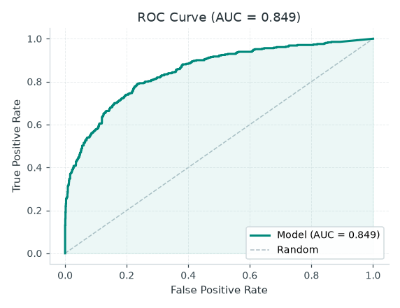 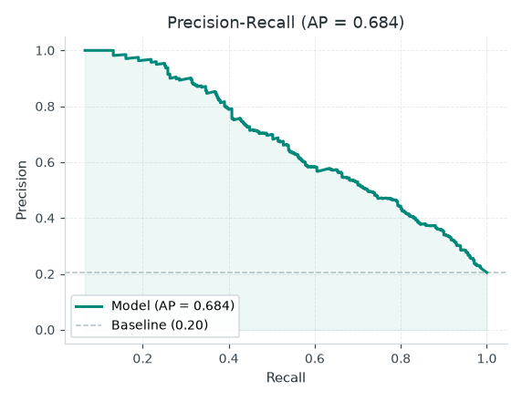

**`plot_cumulative_gain(y, scores)` / `plot_lift(y, scores)`**

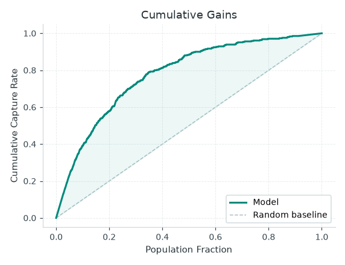 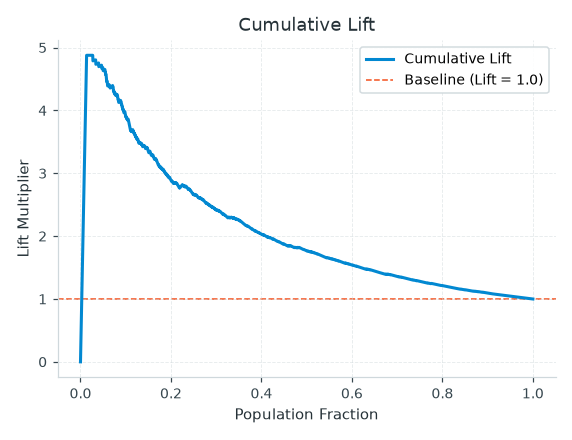

**`plot_ks(y, scores)` / `plot_decile(y, scores, n_buckets=10)`**

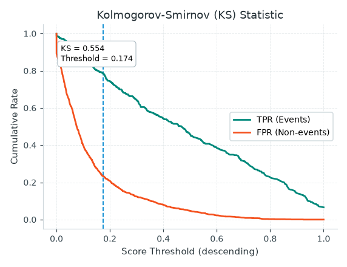 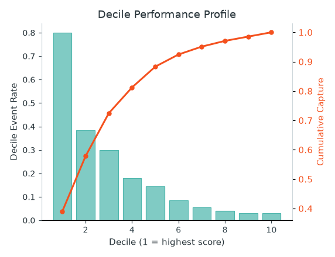

**`plot_calibration(y, scores)` / `plot_response(y, scores)`**

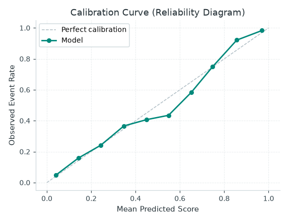
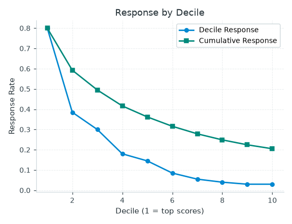

**`plot_double_lift(y, a, b, model_type="ratio")` /
`plot_psi(reference, current, n_bins=10)`**

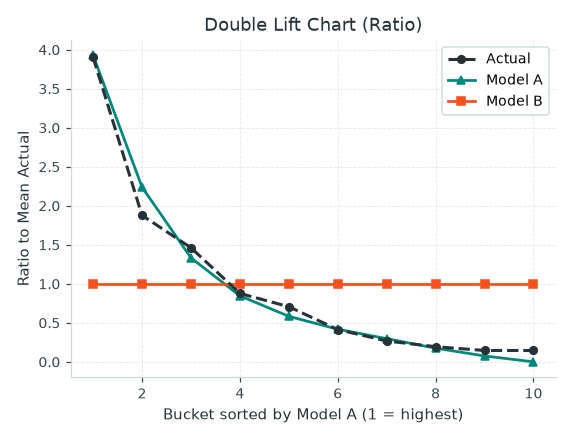
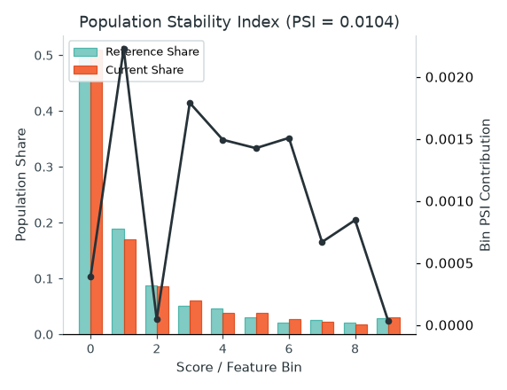

**`plot_confusion_matrix(confusion)` / `plot_residuals(y_true, y_pred)`**

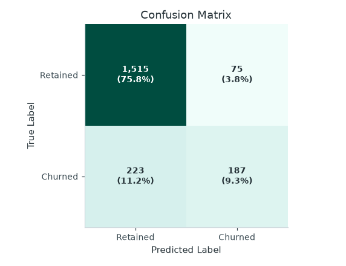
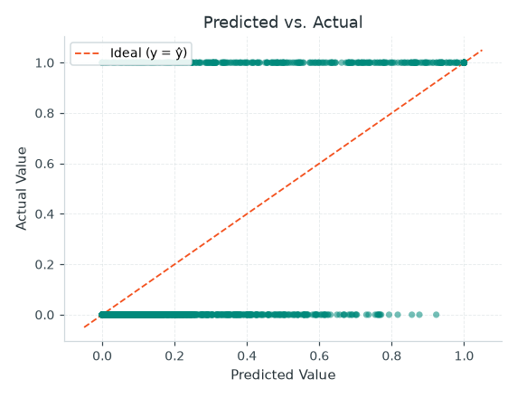

**`plot_importance(model.feature_importance())` /
`plot_breakdown(model.break_down(row))`**

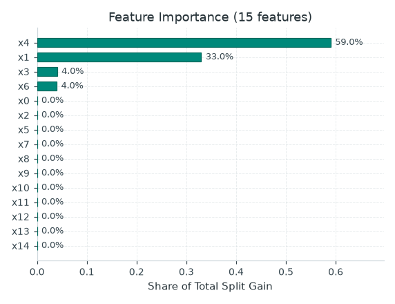
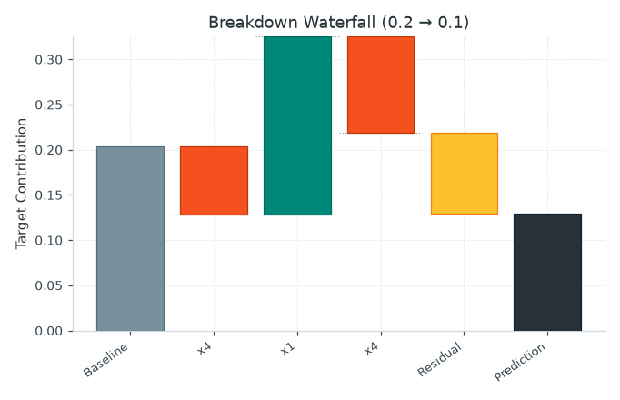

**`plot_variance_shares(generate(...)["truth"]["variance"])` /
`plot_decomposition(values, trend, detrended, deseason, residual)`**

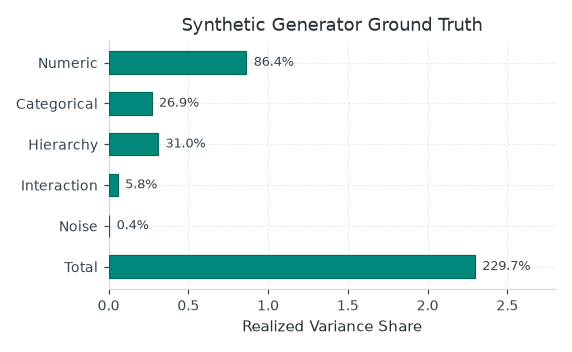

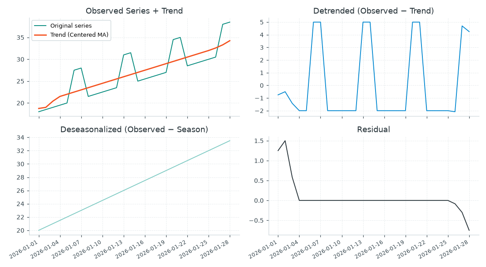

**Reference — next: [Evaluation reports](reports.md)**
