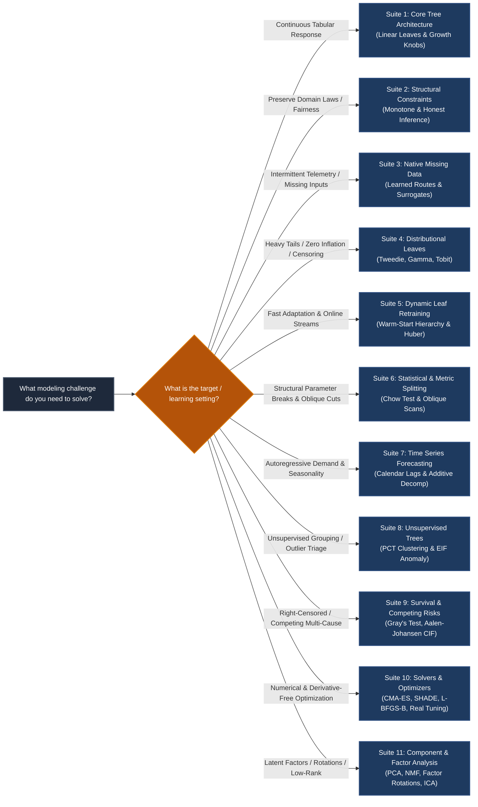

# Benchmark Suites: The 11 Core Modeling Pathways

The 11 benchmark suites test and demonstrate the core capabilities of `mltreelib-core`. Each suite pairs deep mathematical formulation with an executable script in `examples/suites/`, empirical benchmarks on real datasets, and explicit operational limitations.

## Run All Suites

Execute all 11 suites end-to-end via the top-level suite orchestrator:

```bash
uv run python examples/suites/run_all.py
```

Or run an individual suite script directly:

```bash
uv run python examples/suites/core_tree_architecture.py
```

---

## The 11 Benchmark Suites

<div class="grid cards" markdown>

-   :lucide-cpu: __Suite 1: Core Tree Architecture & Growth Knobs__

    ---

    Two-Control decoupling (`ModelTree` $\leftrightarrow$ `LeafControl`), 0D leaf stats, and Chow structural break stopping on Yeh Concrete.

    [:octicons-arrow-right-24: Open Suite 1](core-tree-architecture.md)

-   :lucide-shield-check: __Suite 2: Structural Constraints & Honest Inference__

    ---

    Dual monotone split and slope constraints, interaction isolation, and sample-split honesty ($S^{\text{tr}}$ vs $S^{\text{est}}$) on Healthcare data.

    [:octicons-arrow-right-24: Open Suite 2](constraints-and-honesty.md)

-   :lucide-git-branch: __Suite 3: Native Missing Data Routing__

    ---

    Learned `missing_left` direction and surrogate splits (`maxsurrogate=N`) for zero-imputation telemetry triage on Scania APS.

    [:octicons-arrow-right-24: Open Suite 3](missing-data-routing.md)

-   :lucide-chart-scatter: __Suite 4: Distributional & Censored Leaf Families__

    ---

    Gamma, Poisson, Tweedie, and Tobit censored MLE leaves with 60%+ OLS attenuation correction across actuarial risk datasets.

    [:octicons-arrow-right-24: Open Suite 4](distributional-leaves.md)

-   :lucide-zap: __Suite 5: Dynamic Leaf Retraining & Adaptation__

    ---

    Fast warm-start leaf retraining (~2.2 ms on 1,030 rows), Huber loss breakdown resistance (25.8 vs 54.3 MPa under sensor glitch), and quantile corridors.

    [:octicons-arrow-right-24: Open Suite 5](hierarchical-retrain.md)

-   :lucide-sliders: __Suite 6: Statistical, Metric & Oblique Splitting__

    ---

    Chow structural break gate, oblique ridge splits, Gain Ratio, Twoing, SDR, and Quinlan rule extraction on Housing and Wine.

    [:octicons-arrow-right-24: Open Suite 6](statistical-and-metric-splitting.md)

-   :lucide-calendar-days: __Suite 7: Time Series Feature Engineering & Forecasting__

    ---

    Pure Rust calendar extraction, entity-grouped calendar day lags, additive decomposition, and out-of-time trend extrapolation.

    [:octicons-arrow-right-24: Open Suite 7](timeseries-forecasting.md)

-   :lucide-network: __Suite 8: Unsupervised Trees: Clustering & Anomaly Triage__

    ---

    Predictive Clustering Trees (PCT) with rule extraction and Extended Isolation Forest (EIF) with oblique cuts for multi-target grouping.

    [:octicons-arrow-right-24: Open Suite 8](unsupervised-trees.md)

-   :lucide-heart-pulse: __Suite 9: Survival & Competing Risks Trees__

    ---

    Gray's subdistribution test, weighted log-rank criteria, $O(N)$ streaming martingale scans, and Aalen-Johansen CIF simplex invariant.

    [:octicons-arrow-right-24: Open Suite 9](survival-trees.md)

-   :lucide-gauge: __Suite 10: Solvers, Optimizers & Real-Data Tuning__

    ---

    Unified numerical and evolutionary leaf solvers, standalone weighted GLM fits, bounded black-box optimization, and real-data hyperparameter tuning on Concrete and TabArena tasks.

    [:octicons-arrow-right-24: Open Suite 10](solver-benchmarks.md)

-   :lucide-boxes: __Suite 11: Component & Factor Analysis__

    ---

    Pure Rust PCA, SVD, ZCA/PCA Whitening, FastICA, NMF (MU, ALS, HALS), R-aligned factor rotations (Varimax, Quartimax, Promax), and Minres Factor Analysis with Schmid-Leiman bifactor orthogonalization.

    [:octicons-arrow-right-24: Open Suite 11](component-benchmarks.md)

</div>

---

### Detailed Mechanics Reference Table

| Suite | Focus Area | Benchmark Dataset | Key Mechanics Covered |
| :--- | :--- | :--- | :--- |
| **[Suite 1: Core Tree Architecture & Growth Knobs](core-tree-architecture.md)** | Core Systems | Yeh Concrete (1,030 rows) | Two-Control decoupling (`ModelTree` <-> `LeafControl`), 0D leaf stats, Chow hypothesis stopping. |
| **[Suite 2: Structural Constraints & Honest Inference](constraints-and-honesty.md)** | Physics & Governance | Healthcare Expenses (1,338 rows) | Dual monotone split and slope constraints, interaction isolation, sample-split honesty ($S^{\text{tr}}$ vs $S^{\text{est}}$). |
| **[Suite 3: Native Missing Data Routing](missing-data-routing.md)** | Industrial IoT | Scania APS Failure (76,000 rows) | Learned `missing_left` direction, surrogate splits (`maxsurrogate=N`), zero-imputation telemetry triage. |
| **[Suite 4: Distributional & Censored Leaf Families](distributional-leaves.md)** | Actuarial & Risk | Credit-G, Healthcare, Affairs, Mroz | Gamma, Poisson, Tweedie, and Tobit censored MLE leaves with 60%+ OLS attenuation correction. |
| **[Suite 5: Dynamic Leaf Retraining & Adaptation](hierarchical-retrain.md)** | Streaming & Systems | Yeh Concrete (1,030 rows) | Fast warm-start leaf retraining (~2.2 ms), Huber breakdown resistance (25.8 MPa vs 54.3 MPa under glitch), quantile corridors. |
| **[Suite 6: Statistical, Metric & Oblique Splitting](statistical-and-metric-splitting.md)** | Split Optimization | Boston/Miami Housing, Wine Quality | Chow structural break gate, oblique ridge splits, Gain Ratio, Twoing, SDR, and Rule extraction. |
| **[Suite 7: Time Series Feature Engineering & Forecasting](timeseries-forecasting.md)** | Temporal Econometrics | Multi-store retail demand panel | Pure Rust calendar extraction, entity-grouped calendar day lags, additive decomposition, and out-of-time trend extrapolation. |
| **[Suite 8: Unsupervised Trees: Clustering & Anomaly Triage](unsupervised-trees.md)** | Discovery & Triage | Wine Quality & 2D Mixture | Predictive Clustering Trees (PCT) with rule extraction, Extended Isolation Forest (EIF) with oblique cuts. |
| **[Suite 9: Survival & Competing Risks Trees](survival-trees.md)** | Clinical & Churn | Mayo PBC, Veterans, FLCHAIN | Gray's test, Tarone-Ware/Peto/Martingale, Aalen-Johansen CIF simplex invariant ($\sum F_c + S = 1$), Uno IPCW C. |
| **[Suite 10: Solvers, Optimizers & Real-Data Tuning](solver-benchmarks.md)** | Optimization Systems | Yeh Concrete, Airfoil, Rosenbrock | Analytical Cholesky, L-BFGS, CCD, Evolutionary Solvers (SHADE, CMA-ES, GA, NES), Bounded Optimizers, and Real-Data Tuning. |
| **[Suite 11: Component & Factor Analysis](component-benchmarks.md)** | Representation Learning | Multi-domain psychometrics & TabArena | PCA, SVD, Whitening, FastICA, NMF (MU/ALS/HALS), Factor Analysis (PAF/Minres), Schmid-Leiman, and R-aligned rotations. |

---

## Architectural Workflow Navigator


