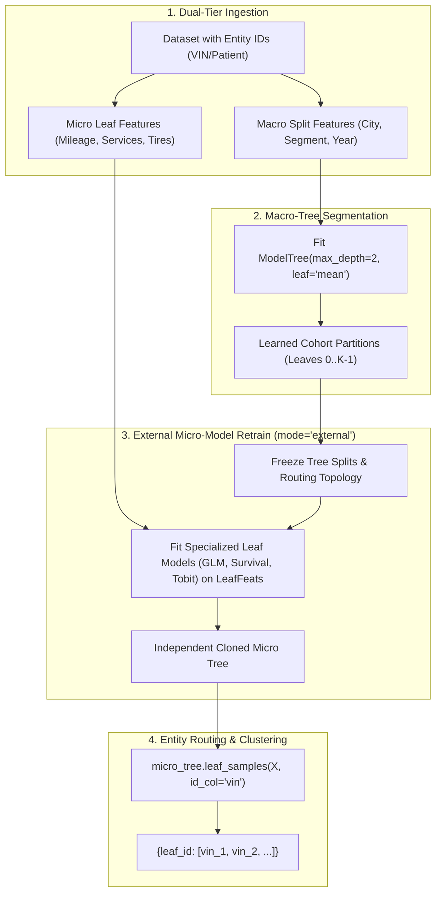

# Gold Standard Architecture: Hierarchical Macro-Tree to Micro-Leaf Retrain & Entity Routing

**Date**: 2026-11-01  
**Author**: Jitin Kapila & Antigravity  
**Status**: Canonical Target Architecture & Gold Standard Workflow  
**Artifacts**:
- Executable Example: [`examples/hierarchical_leaf_retrain.py`](file:///mnt/d/Programs/mltreelib/examples/hierarchical_leaf_retrain.py)
- Documentation Guide: [`docs/examples/hierarchical-retrain.md`](file:///mnt/d/Programs/mltreelib/docs/examples/hierarchical-retrain.md)

---

## 1. Problem Context & Architectural Purpose

Real-world tabular and operational machine learning problems regularly feature a distinct two-tier hierarchy:
1. **Macro-Level Demographics / Cohorts**: Stable coarse segmentation features (e.g. `city`, `market tier`, `vehicle segment`, `model year`, `customer account class`).
2. **Micro-Level High-Frequency Telemetry / Dynamics**: Granular operational attributes (e.g. `distance_km`, `service records`, `accident history`, `tire replacements`, `sensor telemetry`, `local price elasticity`).
3. **Primary Key Entity Identifiers**: Individual entity tracking keys (e.g. `vin`, `patient_id`, `account_id`) that must not be used as split features but must be tracked through partitions.

Treating all variables homogeneously in a single flat decision tree fails:
- High-variance micro-telemetry features can fragment tree splits into brittle, non-generalizable sub-branches.
- Macro segmentation rules lose their human-interpretable cohort grouping.
- Domain experts cannot substitute specialized distributional leaf models (such as survival hazard curves, Tobit hurdle models, or heteroscedastic scale estimators) without retraining the entire tree topology.

---

## 2. The Gold Standard Workflow



---

## 3. Specification & Code Contract

### Stage 1: Macro Tree Fitting
```python
from mltreelib import ModelTree

# Fit macro segmentation tree on coarse cohort features
macro_tree = ModelTree(max_depth=2, min_rows=30, leaf="mean", prune="none")
macro_cols = ["city", "segment", "year"]
macro_tree.fit(macro_rows, targets, col_names=macro_cols)
```

### Stage 2: External Micro Retrain with Decoupled Features
```python
full_cols = ["city", "segment", "year", "distance_km", "service_count", "accidents", "tire_changes"]
micro_cols = ["distance_km", "service_count", "accidents", "tire_changes"]

# Original macro_tree stays frozen; returns new micro_model
micro_model = macro_tree.retrain(
    full_rows,
    targets,
    mode="external",
    col_names=full_cols,
    leaf_features=micro_cols,
    leaf="linear",
    l2=1e-3,
)
```

### Stage 3: Entity Primary Key Routing
```python
# Group primary keys by leaf partition
leaf_clusters = micro_model.leaf_samples(full_rows, id_col=vins)
# {0: ['1HGCR2F800001', '1HGCR2F800008', ...], 1: ['1HGCR2F800002', ...]}
```

---

## 4. Guarantees & Constraints

1. **Topological Invariance**: `mode="external"` guarantees that split thresholds, categorical partitions, and internal node counts of `macro_tree` remain identical bit-for-bit.
2. **Missing Split Feature Enforcement**: Retraining input data *must* contain all split columns used by internal tree branches. If a split column is missing, `retrain` raises `ValueError: required split column '...' missing`.
3. **Decoupled Leaf Feature Subsetting**: `leaf_features` allows the leaf models to ignore macro columns and focus strictly on operational regressors.
4. **Zero Heap Allocation Overhead**: Routing utilizes the fast $O(1)$ scalar work stack (`apply`) without re-evaluating candidate splits.
5. **Entity Decoupling**: Entity IDs (`id_col`) never enter the numerical regression or splitting matrices; they are mapped purely through row indices.
