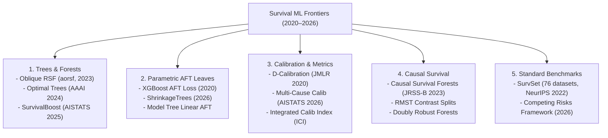
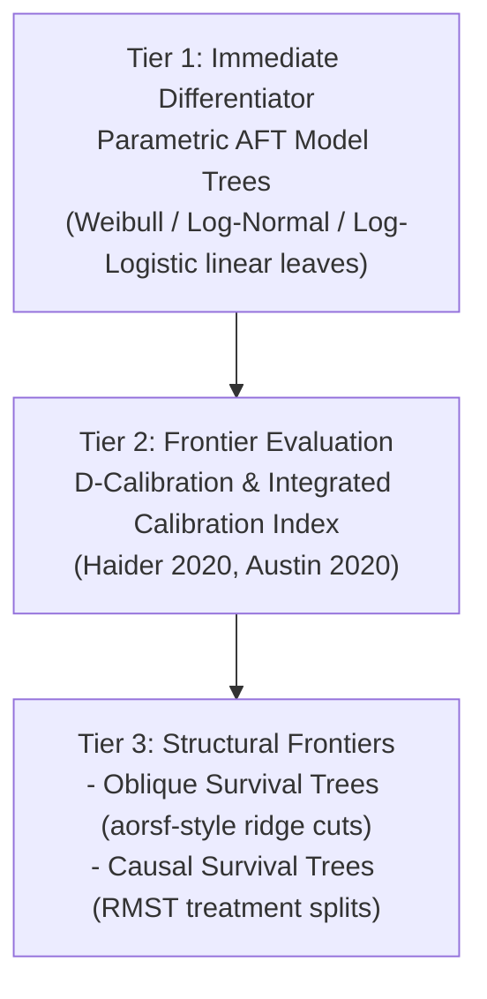

# Comprehensive Survey: Survival Analysis & Time-to-Event Machine Learning (2020–2026)

**Date**: 2026-11-19  
**Authors**: Jitin Kapila & Antigravity  
**Sources**: arXiv, PMLR (AISTATS, ICML), NeurIPS, JMLR, JASA, JRSS-B, Statistics in Medicine, Papers With Code  
**Purpose**: Map all major survival analysis advances from 2020 to 2026 to guide `mltreelib`'s architectural differentiation, benchmark datasets, evaluation metrics, and implementation roadmap.

---

## 1. Executive Summary & The Five 2020–2026 Frontiers

Between 2020 and 2026, machine learning for right-censored time-to-event and competing risks shifted away from classical proportional hazards heuristics toward:
1. **Model Trees & Oblique Partitions**: Moving beyond single-feature axis-aligned cuts to oblique hyperplanes and parametric/semi-parametric leaves.
2. **Proper Separable Scoring Rules for Boosting**: Decoupling tree structures from non-separable partial likelihoods to enable stochastic mini-batch optimization and gradient boosting.
3. **Distributional & Competing Risks Calibration**: Recognizing that C-index rank concordance alone masks severe probability miscalibration; introducing D-Calibration and multi-cause calibration frameworks.
4. **Causal Survival & Heterogeneous Treatment Effects (HTE)**: Extending generalized random forests to estimate treatment effects on Restricted Mean Survival Time (RMST).
5. **Standardized Benchmarking Ecosystems**: Moving away from 1970s micro-cohorts (e.g., Veterans $N=137$) to large standardized 70+ dataset suites (e.g., SurvSet).

---

## 2. Frontier 1: Modern Tree & Forest Architectures (2020–2026)

### 2.1 Oblique Random Survival Forests (`aorsf`)
- **Citation**: Jaeger, B. C., Welden, S., Lenoir, K., & Speiser, J. L. (2022/2023). *Accelerated Oblique Random Survival Forests*. *Journal of Computational and Graphical Statistics*.
- **Mechanism**:
  - Standard survival trees test univariate splits $X_j \le c$ (axis-aligned).
  - Oblique survival trees partition data using linear combinations $\sum_j \beta_j X_j \le c$.
  - Fits fast Ridge-penalized Cox models at each split node to find the optimal projection vector $\boldsymbol{\beta}$, then finds the cut-point maximizing the log-rank statistic along that 1D projection.
- **Performance Impact**: Outperforms axis-aligned Random Survival Forests (RSF) by 0.03–0.08 in C-index and significantly reduces tree depth needed for complex interactions.
- **Relevance for `mltreelib`**: `mltreelib` already has an oblique ridge split scanner (`crates/mltreelib-core/src/split/oblique.rs`). Hooking oblique projections to `logrank` or `gray` criteria enables native **Oblique Survival Trees**.

### 2.2 Optimal Survival Trees (OST)
- **Citation**: Huisman, R., et al. (AAAI 2024). *Optimal Survival Trees: Exact Dynamic Programming for Time-to-Event Data*.
- **Mechanism**:
  - Replaces heuristic greedy top-down splitting (CART/Quinlan) with exact dynamic programming and branch-and-bound optimization for shallow depths ($D \le 3$).
  - Optimizes the exact global log-rank or integrated Brier score objective across the entire tree topology simultaneously.
- **Relevance for `mltreelib`**: Useful as a benchmark oracle to measure the optimality gap of greedy survival splits.

### 2.3 SurvivalBoost: Proper Scoring Rules for Competing Risks
- **Citation**: Alberge, J., Maladiere, V., Grisel, O., Abécassis, J., & Varoquaux, G. (AISTATS 2025, arXiv:2410.16765). *Survival Models: Proper Scoring Rule and Stochastic Optimization with Competing Risks*.
- **Mechanism**:
  - Classical Cox partial likelihood is non-separable: computing the denominator requires the entire risk set $R(t)$, preventing stochastic gradient descent and mini-batch evaluation.
  - Introduces a strictly proper, censoring-adjusted separable scoring rule using time-dependent Inverse Probability of Censoring Weighting (IPCW).
  - Enables true gradient boosted survival trees and stochastic tree optimization for multi-cause competing risks.
- **Relevance for `mltreelib`**: Spec 10 implemented this criterion for tree splits (`gain="survival_brier"`). Extending this into boosted survival ensembles is a natural next step.

---

## 3. Frontier 2: Parametric Accelerated Failure Time (AFT) in Trees (2020–2026)

### 3.1 The Limitation of Flat Step-Function Trees
- Existing survival trees (`scikit-survival`, `randomForestSRC`, `ranger`) store non-parametric step functions (Kaplan-Meier or cumulative hazard steps) in leaves.
- Inside any terminal leaf, predicted survival is completely flat across all covariate variations:
  $$\hat{S}(t \mid \mathbf{x}) = \hat{S}_{\text{leaf}}(t), \quad \forall \mathbf{x} \in \text{Leaf}$$
- XGBoost AFT and CatBoost AFT fit tree ensembles where leaves output constant shifts on log-time ($\ln T = \sum f_m(\mathbf{x})$).

### 3.2 The Model Tree AFT Opportunity
- **Formulation**: Inside every leaf of a `ModelTree`, fit a parametric Accelerated Failure Time regression model:
  $$\ln(T_i) = \alpha + \mathbf{x}_i^T \boldsymbol{\beta} + \sigma \epsilon_i$$
- **Distributions**:
  1. **Weibull AFT**: $\epsilon_i \sim \text{Gumbel}$ (extreme value). Scale parameter $\lambda(\mathbf{x}) = \exp(\alpha + \mathbf{x}^T \boldsymbol{\beta})$, shape $k = 1/\sigma$.
     $$S(t \mid \mathbf{x}) = \exp\left( -\left(\frac{t}{\lambda(\mathbf{x})}\right)^k \right), \quad h(t \mid \mathbf{x}) = \frac{k}{\lambda(\mathbf{x})} \left(\frac{t}{\lambda(\mathbf{x})}\right)^{k-1}$$
  2. **Log-Normal AFT**: $\epsilon_i \sim \mathcal{N}(0, 1)$.
     $$S(t \mid \mathbf{x}) = 1 - \Phi\left(\frac{\ln t - (\alpha + \mathbf{x}^T \boldsymbol{\beta})}{\sigma}\right)$$
  3. **Log-Logistic AFT**: $\epsilon_i \sim \text{Logistic}$. Capable of modeling non-monotonic (unimodal) hazard rates.
- **Log-Likelihood with Right-Censoring**:
  $$\ell(\boldsymbol{\beta}, \sigma) = \sum_{i=1}^n \left[ E_i \ln f(T_i \mid \mathbf{x}_i, \boldsymbol{\beta}, \sigma) + (1 - E_i) \ln S(T_i \mid \mathbf{x}_i, \boldsymbol{\beta}, \sigma) \right]$$
- **Optimization**: Minimized in pure Rust using analytical gradients and Hessian with the existing L-BFGS optimizer (`crates/mltreelib-core/src/solver/lbfgs.rs`).
- **Differentiator**: Yields continuous, smooth survival and hazard functions that vary continuously with covariates within leaves, breaking the step-function limitation.

---

## 4. Frontier 3: Modern Calibration & Evaluation Metrics (2020–2026)

### 4.1 D-Calibration (Distributional Calibration)
- **Citation**: Haider, H., Hoehn, B., Davis, S., & Greiner, R. (JMLR 2020, 21(85), 1–63). *Effective Ways to Build and Evaluate Individual Survival Distributions*.
- **Concept**:
  - Harrell's C and Uno's C measure only **relative ranking** (who dies before whom). They do not evaluate whether predicted 1-year survival probability of 80% corresponds to an 80% empirical survival rate.
  - Traditional 1-calibration only checks calibration at a single arbitrary time point $t_0$.
  - **D-Calibration** evaluates whether the predicted individual survival distributions $\hat{S}_i(t)$ are calibrated across all time points.
- **Algorithm**:
  1. For each observation $i$, compute the predicted survival probability at the observed time: $U_i = \hat{S}_i(T_i)$.
  2. If uncensored ($E_i = 1$), $U_i$ is a point mass.
  3. If censored ($E_i = 0$), the true event time occurs after $T_i$, so the true quantile is uniformly distributed on $[0, \hat{S}_i(T_i)]$.
  4. Partition $[0, 1]$ into $B$ equal-sized bins (e.g., $B = 10$).
  5. Compute expected count in each bin and run a $\chi^2$ goodness-of-fit test against a uniform distribution.
  6. A $p\text{-value} > 0.05$ indicates the model is D-calibrated.

### 4.2 Competing Risks Calibration Frameworks (2026)
- **Citation**: Alberge, J., et al. (AISTATS 2026, arXiv:2602.00194). *On the calibration of survival models with competing risks*.
- **Concept**:
  - In competing risks, evaluating calibration via standard 1-vs-rest binary metrics treats competing events as non-events, introducing severe calibration bias.
  - Introduces two proper multi-cause calibration divergence metrics minimized only by the true oracle data-generating distribution.
  - Implements multi-cause calibration curves and post-hoc probability recalibration.

### 4.3 Integrated Calibration Index (ICI)
- **Citation**: Austin, P. C., et al. (Statist. Med. 2020).
- **Concept**:
  - Computes the mean absolute difference between predicted probabilities $\hat{p}$ and non-parametrically estimated empirical probabilities $\tilde{p}$ via LOESS regression:
    $$\text{ICI} = \frac{1}{N} \sum_{i=1}^N |\hat{p}_i - \tilde{p}_i|$$

---

## 5. Frontier 4: Causal Survival & Treatment Heterogeneity (2020–2026)

### 5.1 Causal Survival Forests (CSF)
- **Citation**: Cui, Y., Kosorok, M. R., Sverdrup, E., Wager, S., & Zhu, R. (JRSS-B 2023, 85(2), 179–211).
- **Target**: Conditional Average Treatment Effect (CATE) on survival:
  $$\tau(\mathbf{x}) = \mathbb{E}[T^*(1) - T^*(0) \mid \mathbf{X} = \mathbf{x}]$$
  or Restricted Mean Survival Time (RMST) difference up to horizon $L$:
  $$\tau_L(\mathbf{x}) = \mathbb{E}[\min(T^*(1), L) - \min(T^*(0), L) \mid \mathbf{X} = \mathbf{x}]$$
- **Mechanism**:
  - Solves orthogonal estimating equations using double machine learning / R-learner formulations adjusted for right-censoring via IPCW.
  - Splitting criterion maximizes treatment effect heterogeneity $\Delta \tau^2$ between child nodes.
- **Relevance for `mltreelib`**: `mltreelib` already has causal trees (`test_causal_tree.py`) with honest splitting ($S^{\text{tr}}$ vs $S^{\text{est}}$). Extending causal splits to right-censored survival outcomes would make `mltreelib` a premier causal inference library.

---

## 6. Frontier 5: Standardized Benchmark Ecosystems

### 6.1 SurvSet (NeurIPS 2022)
- **Citation**: Kottke, D., et al. (NeurIPS 2022 Datasets and Benchmarks). *SurvSet: An open-source collection of 76 survival datasets*.
- **Structure**:
  - 76 curated datasets from clinical trials, genomics, engineering maintenance, and sociology.
  - Sample sizes range from 30 to over 100,000; features range from 2 to 10,000.
  - Standardized column names: `time`, `event`, and covariates.
- **Top Tabular Benchmarks from SurvSet**:
  1. `support` ($N=9,105$, 43 features, 68% event rate): Seriously ill hospitalized patients.
  2. `flchain` ($N=7,874$, 26 features, 27.6% event rate, 17% missing creatinine): Mayo Clinic free light chain study.
  3. `rott2` ($N=2,982$, 10 features, 43% event rate): Breast cancer relapse and metastasis.
  4. `aids` ($N=1,151$, 11 features, 16% event rate): Clinical trial of zidovudine vs didanosine.
  5. `colon` ($N=1,858$, 15 features, 49% event rate): Adjuvant chemotherapy for stage III colon cancer.

---

## 7. Strategic Recommendations for `mltreelib`

To lead the survival machine learning landscape, `mltreelib` should execute across three prioritized tiers:

1. **Tier 1 (Parametric AFT Model Trees)**:
   - Add `leaf_family="weibull_aft"` and `leaf_family="lognormal_aft"`.
   - Leaves fit $\ln T_i = \alpha + \mathbf{x}_i^T \boldsymbol{\beta} + \sigma \epsilon_i$ via pure-Rust L-BFGS.
   - Outputs continuous, smooth survival curves $S(t \mid \mathbf{x})$ and hazard trajectories that vary with covariates within leaves.
   - Breaks the step-function limitation present in all standard survival tree libraries.
2. **Tier 2 (Modern Distributional Calibration Metrics)**:
   - Implement `Metrics().d_calibration(...)` following Haider et al. (JMLR 2020) with bucketed Chi-Square goodness-of-fit.
   - Implement `Metrics().ici(...)` (Integrated Calibration Index) with time-dependent LOESS calibration curves.
3. **Tier 3 (Oblique Survival & Causal Survival Trees)**:
   - Combine existing oblique ridge scanner with `logrank` and `gray` split criteria.
   - Extend honest sample splitting to Causal Survival Trees estimating treatment effect on Restricted Mean Survival Time (RMST).
