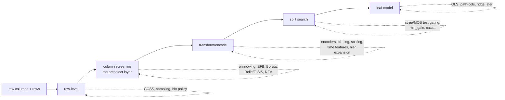

# Pre-selection & pre-processing catalog — every stage, every combination

**Date:** 2026-10-28. **Companion to:** `preselection-and-expert-thesis.md`.
**Purpose:** one place to see *all* the pre-processing stages the surveyed
methods perform, so we can compose them deliberately. The two anchor methods
(Jitin's): **LightGBM EFB** ("bundle mutually-exclusive sparse features into
single features") and **C5.0's pre-build case analysis / winnowing** — both
live in the vendors' *code* more than in their published algorithm
descriptions, hence this catalog.

## 1. The stage menu (when each runs)

## 2. Row-level (before any search)

| step | method | what it does | source |
|---|---|---|---|
| instance sampling | C5.0 `-x` sample / Cubist sampling | train on a sample, test on the rest | see5/cubist docs |
| gradient-based row keep | **LightGBM GOSS** | keep all large-gradient rows, sample + rescale small-gradient rows | Ke et al. 2017 |
| NA policy | drop / impute / learned default directions | decides what rows/paths exist | our `NaPolicy`; perpetual's learned missing |
| weighting | C5.0 case weights | importance per row | see5 docs |

## 3. Column screening — the `preselect` layer (this is the build target)

| step | method | screen | granularity | source |
|---|---|---|---|---|
| utility screen | **C5.0 winnowing** (`-w`) | attribute utility vs class, *before* the tree is built; survivors ranked by importance; winnowed cols may still feed derived attributes | feature | see5-unix.md:1110-1256 |
| bundle sparse | **LightGBM EFB** | conflict graph over mutually-exclusive sparse features → graph coloring → bundled columns | feature | Ke et al. 2017 |
| relevance vs shadows | **Boruta** | RF importance vs permuted shadow copies; keep all-relevant | feature | boruta-fru in sources |
| neighborhood relevance | **ReliefF** | local difference weighting | feature | mlxtend catalog |
| marginal screen | **SIS** (Fan & Lv 2008) | correlation rank before any model | feature | literature |
| selection as path | **mboost/glmboost** | coefficient paths; early stopping = the cut | feature | mboost source |
| dispersion | variance / near-zero-variance | drop constants | feature | universal |
| redundancy | correlation pruning / clustering | merge correlated columns | feature | common practice |

## 4. Transform-level (after screening, before/at search)

| step | method | source |
|---|---|---|
| categorical encoding | our 12 encoders (one-hot, hashing, target, CatBoost-ordered, LOO, M-est, base-N, count, sum, quantile, James-Stein, WoE, class-level TF-IDF, embeddings) | `encode.rs` |
| cat×cat combinations | CatBoost-style ordered combinations inside the split search | 03-boosting.md |
| discretization | ChiMerge/CHAID-style category merging; quantile binning | 01-single-trees.md |
| scaling | VariableScaler/GroupedScaler | `transform.rs` |
| time features | `windowed_transform`, `lag_by_days`, `trended_transform` | `timefeat.rs` |
| hierarchy expansion | `hier_*`, `org_hier_*`, `group_id` — the categorical **trie paths** | dataset-component-design |
| target transform | log/quantile targets (cf. quantile GBT) | 05-bayesian-quantile.md |

## 5. Split-time gating (during search — the cousin of pre-selection)

| step | method | source |
|---|---|---|
| association tests | ctree global null + multiplicity-adjusted p | 01-single-trees.md |
| model instability | MOB supLM/chisq on the leaf model | 01-single-trees.md |
| min_gain / min_rows | universal stopping | all |
| test-based variable pick | CTBoost (ctree inside boosting) | 09-tabarena-field.md |

## 6. Leaf-level (our new surface)

| step | option | status |
|---|---|---|
| leaf model | **full OLS** (all usable columns) | **v1 — building now** |
| leaf columns | **PathUsed** (only split-path columns — segmented/piecewise-linear flavor, APLR-like) | **v1 — building now** |
| leaf regularization | ridge / lasso / elastic net | later |
| leaf non-parametric | local kernel / KNN (TrieKNN flavor) | later |

## 7. Recipes — the combinations worth trying

| recipe | row | column | transform | leaf | intent |
|---|---|---|---|---|---|
| **honest base** | NA-drop | none | none | OLS all | the v1 baseline |
| **winnowed** | NA-drop | winnowing-style utility | none | OLS all | C5.0 parity |
| **path-piecewise** | NA-drop | none | none | OLS PathUsed | segmented regression (APLR-like) |
| **EFB+winnow** | NA-drop | EFB bundle then utility | one-hot/sparse | OLS all | wide sparse data |
| **GOSS+winnow** | GOSS | utility | none | OLS all | large-n |
| **encoded-categorical** | NA-drop | utility incl. encoded | target/ordered-TS | OLS all | churn-like categoricals |
| **hier-aware** | NA-drop | utility + hier expansion | group_id levels | OLS all | `hier_*` features |
| **time-aware** | windowed rows | utility | windowed/lag | OLS all | drift datasets |
| **screened-all** | GOSS | Boruta + EFB + NZV | full encoder suite | OLS all | kitchen sink |

## 8. How to read this for the build

1. The **preselect layer** = §3 (+§2 rows): a `preselect` stage handing the
   split search a survivor column set. Effects to measure: search-space size
   AND structure recovery (planted columns survive, junk dies).
2. The **single tree** = §5 + §6: `model_tree.rs` (v1: honest OLS leaves,
   `LeafCols::{All, PathUsed}` — the two policies the thesis names).
3. Everything here plugs into the existing layer (`builder.rs` policies,
   `encode.rs`, `transform.rs`, `timefeat.rs`) — no new vocabularies.
